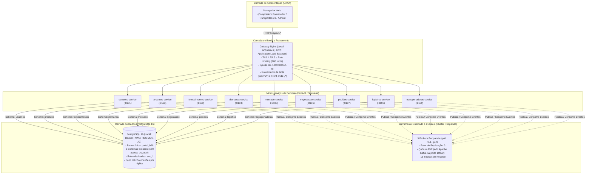

# GUIA DE DIRETRIZES ARQUITETURAIS E INTEGRAÇÃO — PORTAL B2B DISTRIBUÍDO
**Documento Unificado de Orientações Técnicas para Todas as Equipes**  
**Emissor:** Equipe de Infraestrutura e DevOps  
**Data:** Outubro de 2026  
**Versão:** 1.0 — Oficial para Desenvolvimento e Homologação  

---

## 1. Apresentação e Propósito

Este documento foi elaborado pela **Equipe de Infraestrutura** para alinhar e orientar todos os 9 grupos de trabalho do projeto integrado da disciplina de **Sistemas Distribuídos**. 

O **Portal B2B Distribuído** é uma plataforma corporativa complexa, baseada no paradigma de **Microsserviços Orientados a Eventos (*Event-Driven Architecture*)**, projetada para operar em topologia redundante na nuvem da AWS e em ambiente local reprodutível.

Para que as entregas individuais funcionem de forma harmônica, sem falhas de integração ou acoplamento indevido, **todas as equipes devem seguir rigorosamente as convenções, contratos e diretrizes descritas neste guia**.

---

## 2. Mapa dos Grupos de Trabalho e Atribuições

A tabela a seguir consolida os grupos de trabalho (conforme distribuição oficial) e suas respectivas responsabilidades dentro da arquitetura:

| Grupo de Trabalho | Integrantes Responsáveis | Serviços / Componentes Atribuídos | Portas Locais | Schema PostgreSQL |
|---|---|---|:---:|:---:|
| **1. Autenticação (Equipe A)** | Matheus Alves, Marcos Vinícius Brandão, Vinícius Rodrigues, Ludmila Lima | `usuarios-service` (Auth, JWT, Empresas, RBAC, LGPD) | `8101` | `usuarios` |
| **2. Fornecimento e Produtos** | Daniel Coutinho, Davi Alvarenga, Gabriel Vicentte, Rafael Noleto | `produtos-service`, `fornecimentos-service` (Catálogo e Estoque) | `8102`<br>`8103` | `produtos`<br>`fornecimentos` |
| **3. Compra e Demanda** | Lucca Stuart, Gabriel Martins, Matheus Caetano, Daniel Teixeira, Gabriel Whinter | `demanda-service` (Demandas pontuais e recorrentes) | `8104` | `demanda` |
| **4. Mercado, Negociação e Pedidos** | Brunno Alexcson, Caio Almeida, Daniel Junio Barbosa | `mercado-service` (Matching Engine), `negociacao-service` (Leilões/Venda Direta), `pedidos-service` | `8105`<br>`8106`<br>`8107` | `mercado`<br>`negociacao`<br>`pedidos` |
| **5. Logística e Transporte** | Gabriel Borges, Pedro Blamires, Gabriel Rodrigues, Heitor Deodato, Jefferson Felex | `logistica-service`, `transportadoras-service` (Cotações e Despacho) | `8108`<br>`8109` | `logistica`<br>`transportadoras` |
| **6. Banco de Dados** | Rafael Borba, Rafaella Agapito, Leonardo Oliveira, João Pedro Lima, Marcus Vinícius Silva | Modelagem relacional, DDL versionado, Roles, Trilha de auditoria, Migrações e Pools | `5432` | Banco `portal_b2b`<br>(9 Schemas) |
| **7. UX / UI** | Eduardo Souza Andrade, Hugo Guilherme | 7 Front-ends estáticos (HTML5/React/Vite) e Design System unificado | Borda (Nginx) | — |
| **8. Teste e Qualidade** | Amanda Barbosa, Kayky Momoli, Lavínia Moreira, Gabriel Jonas, Matheus Pains, Igor Santos, Nicole Gomes, Igor Balduíno | Suíte independente de testes funcionais, integração, carga (k6) e caos | — | — |
| **9. Infraestrutura e DevOps** | Pedro Cardoso da Mata, Antoniel Brito Andrade, Flaelisnanda Oliveira Dacio | Gateway Nginx, Nuvem AWS (Terraform), Cluster Redpanda, Observabilidade e CI/CD | `8080` (GW)<br>`19092` (Kafka) | Gestão Geral |

---

## 3. Visão Geral da Arquitetura do Sistema

O Portal B2B opera sob o princípio de **baixo acoplamento temporal**. Nenhuma API síncrona deve chamar outra API diretamente para fluxos de negócio; todo o avanço do processo de compras, leilões e logística ocorre por emissão e consumo de eventos no cluster Redpanda (compatível com a API do Apache Kafka).



---

## 4. Diretrizes Obrigatórias para os Desenvolvedores de Microsserviços

Esta seção aplica-se aos grupos de **Autenticação**, **Fornecimento e Produtos**, **Compra e Demanda**, **Mercado, Negociação e Pedidos** e **Logística e Transporte**.

### 4.1 Padrão de Endpoints REST
- Todas as rotas de negócio devem obrigatoriamente iniciar com o prefixo versionado: `/api/v1/<servico>`.
  - Exemplo: `POST /api/v1/demandas`, `GET /api/v1/produtos`, `POST /api/v1/negociacoes/{id}/lances`.
- **Nenhum serviço deve expor rotas fora de `/api/v1/`**, exceto endpoints técnicos (`/health`, `/metrics`, `/docs`).

### 4.2 Endpoints Técnicos Obrigatórios em TODAS as APIs
Cada um dos 9 microsserviços deve implementar impreterivelmente os seguintes endpoints na raiz:

1. **`GET /health` (Liveness Probe):**
   - Retorna HTTP `200 OK` se o processo estiver vivo.
   ```json
   {
     "status": "UP",
     "service": "produtos-service",
     "timestamp": "2026-10-25T10:00:00Z"
   }
   ```
2. **`GET /health/ready` (Readiness Probe):**
   - Testa ativamente se a aplicação consegue consultar o PostgreSQL e se tem conexão ativa com o cluster Redpanda.
   - Retorna HTTP `200 OK` se todas as dependências responderem, ou HTTP `503 Service Unavailable` se o banco ou o barramento estiverem fora.
3. **`GET /metrics`:**
   - Métricas no formato do Prometheus (contadores de requisições por status code e tempo de resposta).
4. **`GET /docs` e `GET /openapi.json`:**
   - Documentação Swagger/OpenAPI interativa nativa do FastAPI habilitada.

### 4.3 Padrão Obrigatório de Resposta de Erro (RFC 7807)
Nenhuma API deve retornar erros em texto puro ou com formatos customizados. Todas as respostas de erro HTTP (códigos 4xx e 5xx) devem utilizar o padrão **RFC 7807 (Problem Details)** com o cabeçalho `Content-Type: application/problem+json`:

```json
{
  "type": "https://portal-b2b.corp/erros/estoque-insuficiente",
  "title": "Estoque Insuficiente",
  "status": 422,
  "detail": "A quantidade solicitada (101) excede o estoque atual disponível (70).",
  "instance": "/api/v1/fornecimentos/f-123/estoque",
  "correlationId": "d3b07384-d113-4f9e-8c65-27a36c8d76e4",
  "timestamp": "2026-10-25T10:15:30Z"
}
```

### 4.4 Cabeçalho de Rastreabilidade (`X-Correlation-Id`)
- O Gateway Nginx gera ou encaminha um identificador único de correlação no cabeçalho HTTP `X-Correlation-Id`.
- **Regra:** Sua API deve extrair esse cabeçalho da requisição recebida, incluí-lo em **todos os logs gerados em formato JSON** e passá-lo para os metadados dos eventos Kafka que você publicar.
- Se o cabeçalho não vier na requisição, gere um UUID v4.

### 4.5 Padrão de Logs Estruturados
Nunca utilize `print()`. Utilize bibliotecas de log (como `structlog` ou `logging` padrão com formatador JSON) emitindo logs para a saída padrão (`stdout`):
```json
{"timestamp": "2026-10-25T10:20:00Z", "level": "INFO", "service": "pedidos-service", "correlationId": "d3b07384...", "message": "Pedido criado com sucesso", "pedido_id": "ped-9988"}
```

### 4.6 Paginação e Limites
- Todas as rotas de listagem (`GET`) devem implementar paginação: `?page=1&size=10`.
- É **terminantemente proibido** retornar listas irrestritas.
- Se o cliente requisitar `size > 100`, a API deve rejeitar a requisição imediatamente com **HTTP 422 Unprocessable Entity**.

---

## 5. Diretrizes para o Grupo de Banco de Dados

O **Grupo de Banco de Dados** tem um papel fundamental na estabilidade e segurança do projeto. A Equipe de Infraestrutura disponibilizou a instância do **PostgreSQL 16** (com suporte a Multi-AZ na nuvem e réplica local síncrona).

### 5.1 Estrutura de Schemas e Isolamento
O banco de dados lógico chamará-se unicamente **`portal_b2b`**. Dentro dele, ficam segregados 9 schemas:
- `usuarios`, `produtos`, `fornecimentos`, `demanda`, `mercado`, `negociacao`, `pedidos`, `logistica`, `transportadoras`.

> [!IMPORTANT]
> **Proibição Absoluta de Joins e Acesso Cruzado:**
> Um microsserviço NUNCA deve realizar consultas (`SELECT`) ou modificações (`INSERT/UPDATE`) em tabelas de schemas que não sejam o seu próprio. Toda troca de informação entre domínios deve ocorrer exclusivamente por **mensageria** ou, quando estritamente necessário, via chamada HTTP pública.

### 5.2 Gerenciamento de Usuários e Permissões (Roles)
O Grupo de Banco de Dados deve manter os seguintes perfis configurados no banco:

1. **`portal_admin`:** Usuário de administração geral da infraestrutura. Não é utilizado por nenhuma aplicação em tempo de execução.
2. **`portal_ddl`:** Usuário exclusivo para execução de scripts de migração estrutural (`CREATE TABLE`, `ALTER TABLE`, `CREATE INDEX`).
3. **`svc_<nome>` (ex.: `svc_pedidos`, `svc_usuarios`):**
   - Usuário exclusivo de conexão de cada microsserviço.
   - Possui permissão restrita de DML (`SELECT`, `INSERT`, `UPDATE`, `DELETE`) **apenas dentro do seu respectivo schema**.
   - Não possui privilégios de `CREATE TABLE`, `DROP` ou acesso a schemas alheios.

### 5.3 Controle Estrito do Pool de Conexões
- A capacidade máxima recomendada do PostgreSQL na nuvem (instância `db.t4g.medium`) é de **100 conexões simultâneas**.
- Como temos 9 microsserviços rodando em 2 instâncias ativas (18 nós de aplicação ao todo), **cada microsserviço deve configurar seu pool de conexões (ex: SQLAlchemy ou asyncpg) para no máximo 5 conexões ativas**:
  $$\text{Total Máximo} = 18 \text{ nós} \times 5 \text{ conexões} = 90 \text{ conexões} \le 100$$
- Ultrapassar esse limite causará quedas do banco de dados e reprovação nos testes de resiliência.

### 5.4 Trilha de Auditoria Imutável
O Grupo de Banco de Dados deve prover uma tabela de auditoria (`audit_log`) append-only (sem permissão de `UPDATE` ou `DELETE` para ninguém), registrando:
`id`, `timestamp`, `correlation_id`, `servico_origem`, `tabela_afetada`, `operacao` (INSERT/UPDATE), `dados_anteriores`, `dados_novos`.

---

## 6. Diretrizes para Mensageria e Eventos (Redpanda / Kafka)

O barramento oficial do projeto é o **Cluster Redpanda** (executando em 3 brokers com fator de replicação 3). As equipes devem utilizar qualquer biblioteca cliente compatível com a API Apache Kafka (como `kafka-python`, `aiokafka` ou `confluent-kafka`).

### 6.1 Catálogo Oficial dos 15 Tópicos de Negócio

| Tópico Kafka | Serviço Produtor (Owner) | Serviços Consumidores | Chave da Mensagem (`Key`) |
|---|---|---|---|
| `empresa_cadastrada` | `usuarios-service` | Todos os serviços | `empresa_id` |
| `usuario_cadastrado` | `usuarios-service` | Auditoria | `usuario_id` |
| `produto_criado` | `produtos-service` | `fornecimentos-service`, `demanda-service` | `produto_id` |
| `fornecimento_criado` | `fornecimentos-service`| `mercado-service` (Matching) | `produto_id` |
| `estoque_atualizado` | `fornecimentos-service`| `mercado-service` | `produto_id` |
| `demanda_criada` | `demanda-service` | `mercado-service` (Matching) | `produto_id` |
| `demanda_recorrente_gerada`| `demanda-service` | `mercado-service` | `produto_id` |
| `modo_negociacao_definido` | `mercado-service` | `negociacao-service` | `negociacao_id` |
| `leilao_iniciado` | `mercado-service` | `negociacao-service`, Front-end | `leilao_id` |
| `lance_realizado` | `negociacao-service` | Front-end, Auditoria | `leilao_id` |
| `negociacao_fechada` | `negociacao-service` | `pedidos-service` | `negociacao_id` |
| `pedido_criado` | `pedidos-service` | `logistica-service`, `fornecimentos-service` | `pedido_id` |
| `pedido_atualizado` | `pedidos-service` | Front-end, Auditoria | `pedido_id` |
| `solicitacao_frete_criada`| `logistica-service` | `transportadoras-service` | `solicitacao_id` |
| `cotacao_recebida` | `transportadoras-service`| `logistica-service` | `solicitacao_id` |
| `frete_selecionado` | `logistica-service` | `pedidos-service` | `pedido_id` |

### 6.2 Envelope Canônico Obrigatório de Mensagem
Nenhum evento pode ser publicado como JSON desestruturado ou string solta. **Todos os eventos devem utilizar rigorosamente a estrutura canônica abaixo**:

```json
{
  "eventId": "a8098c1a-f86e-11da-bd1a-00112444be1e",
  "eventType": "pedido_criado",
  "timestamp": "2026-10-25T10:30:00Z",
  "version": "1.0",
  "source": "pedidos-service",
  "correlationId": "d3b07384-d113-4f9e-8c65-27a36c8d76e4",
  "aggregateId": "ped-998811",
  "payload": {
    "pedidoId": "ped-998811",
    "negociacaoId": "neg-7788",
    "compradorId": "comp-12",
    "fornecedorId": "forn-34",
    "produtoId": "prod-1",
    "quantidade": 100.0,
    "valorTotal": 5000.00,
    "status": "CRIADO"
  }
}
```

### 6.3 Regras de Ouro da Mensageria
1. **Chave de Partição (`Key`):** É **obrigatório** passar o `aggregateId` (ID do pedido, ID do produto ou ID da negociação) como chave da mensagem no Kafka. Isso garante que todos os eventos da mesma entidade caiam na mesma partição e sejam processados na ordem cronológica exata.
2. **Idempotência no Consumo:** A rede pode reentregar eventos. O seu consumidor deve verificar se o `eventId` ou a combinação de negócio já foi processada antes de alterar dados (mantendo uma tabela `processed_events` local no seu schema).
3. **Dead Letter Queue (DLT):** Se uma mensagem apresentar erro irrecuperável de payload ou falha após 3 tentativas com backoff exponencial (1s, 2s, 4s), envie a mensagem para o tópico de descarte `<seu-servico>.dlt`.

---

## 7. Diretrizes para o Grupo de Autenticação (Equipe A)

### 7.1 Formato e Assinatura do Token JWT
- A autenticação é stateless baseada em **JWT (RFC 7519)**.
- O token deve conter os seguintes claims obrigatórios:
  - `sub`: Identificador do usuário (UUID).
  - `empresa_id`: Identificador da empresa à qual o usuário pertence.
  - `perfil`: Um entre `comprador`, `fornecedor`, `transportadora` ou `admin`.
  - `exp`: Timestamp de expiração.
- **Validade dos Tokens:**
  - **Access Token:** Exatamente **15 minutos**.
  - **Refresh Token:** Exatamente **8 horas**.

### 7.2 Regras de Controle de Acesso (RBAC)
Cada serviço deve validar o perfil contido no JWT e recusar chamadas indevidas com **HTTP 403 Forbidden**:
- Perfil `comprador` só pode criar demandas e dar lances de compra; tentar acessar rotas de fornecedores deve resultar em 403.
- Perfil `fornecedor` só pode publicar ofertas e gerenciar estoque próprio; tentar postar demandas deve resultar em 403.
- Perfil `transportadora` só pode submeter cotações em solicitações de frete.
- Perfil `admin` tem acesso à auditoria e relatórios gerenciais.

### 7.3 Conformidade com a LGPD
- O `usuarios-service` deve expor o endpoint: `POST /api/v1/usuarios/{id}/anonimizar`.
- Quando acionado, o nome, e-mail e dados pessoais devem ser substituídos por hashes irreversíveis (`Anonimizado-XXXX`), mantendo os registros de compras e histórico transacional íntegros.

---

## 8. Diretrizes para o Grupo de Logística e Transporte

### 8.1 Ciclo de Cotação e Seleção de Frete
1. O `logistica-service` consome o evento `pedido_criado` e dispara o evento `solicitacao_frete_criada`.
2. O `transportadoras-service` emite cotações simuladas das transportadoras homologadas (`cotacao_recebida`).
3. O `logistica-service` aguarda o recebimento das propostas (com timeout máximo de 10 segundos).
4. **Critério Inegociável de Escolha:**
   - **1º Critério:** Menor preço de frete.
   - **Critério de Desempate:** Menor prazo de entrega em dias úteis.
5. Ao selecionar a vencedora, emite `frete_selecionado`, fazendo o pedido transitar para `FRETE_SELECIONADO`.

---

## 9. Diretrizes para o Grupo de UX/UI

### 9.1 Ponto de Entrada e Roteamento
- Os 7 front-ends devem ser entregues como **aplicações web estáticas (Single Page Applications - SPAs)** construídas em HTML5, JavaScript moderno ou React/Vite.
- Todas as requisições para o backend devem apontar para a porta do **Gateway Nginx** (`http://localhost:8080/api/v1/...` no ambiente local). **Nunca aponte o front-end diretamente para as portas internas das APIs (8101 a 8109)**.

### 9.2 Distribuição de Subcaminhos dos Front-ends
O Gateway Nginx mapeará as seguintes interfaces sob os subcaminhos:
- `/`: Portal Principal / Autenticação e Cadastro
- `/app/produtos`: Catálogo e Gestão de Estoque do Fornecedor
- `/app/demandas`: Central de Demandas do Comprador
- `/app/negociacoes`: Sala de Leilões e Negociações em Tempo Real
- `/app/pedidos`: Painel de Pedidos e Rastreio
- `/app/logistica`: Painel da Transportadora e Cotações de Frete
- `/app/admin`: Painel de Governança e Auditoria

### 9.3 Tratamento Visual de Erros
- Quando o backend responder com códigos 4xx ou 5xx no padrão RFC 7807, capture os campos `title` e `detail` para exibir mensagens claras e humanizadas ao usuário.
- Sempre exiba no rodapé de mensagens de erro o campo `correlationId`, facilitando o suporte técnico caso o usuário precise relatar um problema.

---

## 10. Diretrizes para o Grupo de Teste e Qualidade

O **Grupo de Teste** é responsável por auditar de forma **independente e cega** todo o ecossistema. Vocês não devem confiar em declarações estáticas dos outros grupos; tudo deve ser comprovado via suítes de teste reais.

### 10.1 Ferramentas Recomendadas
- **Testes de APIs e Contratos:** Pytest com `httpx`, Postman / Newman ou Bruno.
- **Testes de Carga e Estresse:** **k6** (cenários declarativos em JavaScript) ou Locust.
- **Testes de Resiliência e Caos:** Scripts shell disparando falhas no Docker/Postgres.

### 10.2 Metas de Qualidade e Critérios de Aceite (SLAs)
A suíte do Grupo de Teste deve reprovar qualquer serviço que viole os seguintes patamares:
1. **Latência de Leitura (p95):** Menor ou igual a **500 ms** em chamadas de catálogo e listagem sob carga de 200 requisições simultâneas.
2. **Latência de Escrita (p95):** Menor ou igual a **1000 ms** para criação de pedidos, lances e lances de leilão.
3. **Taxa de Erro HTTP 5xx:** Menor que **1%** sob estresse.
4. **Idempotência Real:** Enviar o mesmo evento `negociacao_fechada` 5 vezes seguidas para o `pedidos-service` deve gerar **exatamente 1 pedido** no banco de dados. Os outros 4 devem ser ignorados com log de "evento já processado".
5. **Segregação de Segurança (RBAC):** Testar requisições forjadas com token de comprador tentando criar fornecimento -> deve obrigatoriamente retornar **HTTP 403**.

---

## 11. O Kit de Integração da Infraestrutura (Repositório Oficial)

Para facilitar a vida de todos os alunos e garantir que ninguém perca tempo configurando bancos ou brokers do zero, a **Equipe de Infraestrutura empacotou um repositório completo e autocontido chamado `kit-integracao-infraestrutura/`**, pronto para ser clonado e utilizado por todas as equipes.

### 11.1 O que o Kit Entrega para o seu Grupo
1. **Banco de Dados PostgreSQL 16 Pré-configurado:** Com o banco `portal_b2b`, os 9 schemas já criados e as credenciais DML isoladas para cada equipe (arquivo `database/01-init.sql`).
2. **Cluster Redpanda Pronto:** 3 brokers Kafka na porta `19092` com script automatizado (`scripts/init_topics.sh`) para criar os 15 tópicos oficiais.
3. **Gateway de Borda Nginx:** Roteamento de rotas `/api/v1/*`, terminação TLS e rate limiting já ativos na porta `8080`.
4. **Painéis Visuais Web:** PgAdmin na porta `5050` e Kafka UI na porta `8090` para monitoramento em tempo real.
5. **Boilerplates de Microsserviços (`services/*`):** Esqueleto funcional de cada uma das 9 APIs em FastAPI, já com Dockerfile, endpoints `/health`, `/metrics`, documentação Swagger (`/docs`) e o tratamento padronizado de erros RFC 7807.
6. **Catálogo de Contratos e Payloads (`CONTRACTS.md`):** Exemplos dos payloads JSON para todos os 15 tópicos de mensagens.

### 11.2 Como Inicializar a Infraestrutura no seu Computador
Dentro da pasta do Kit, você pode utilizar o `Makefile` incluído ou comandos diretos do Docker:

```bash
# 1. Copiar as variáveis de ambiente padrão
make env
# (Ou: cp .env.example .env)

# 2. Inicializar a infraestrutura base (Postgres + Redpanda + Gateway + UIs)
make infra-up
# (Ou: docker compose up -d pg-primary rp-0 rp-1 rp-2 gateway pgadmin kafka-ui frontends)
```

### 11.3 Duas Formas de Desenvolver o seu Microsserviço
- **Modo Recomendado (Rápido com Hot-Reload):** Suba apenas a infraestrutura base (`make infra-up`). Em seguida, entre na pasta do seu serviço (ex: `services/demanda-service`), ative um ambiente virtual Python (`python -m venv venv`), instale os pacotes (`pip install -r requirements.txt`) e execute `uvicorn main:app --reload --port <sua_porta>`. Seu serviço já conversará diretamente com o banco e o Kafka locais.
- **Modo Stack Completa em Contêineres:** Se quiser rodar todos os serviços juntos para testar o fluxo integrado, execute `make up` (ou `docker compose up -d`).

### 11.4 URLs e Ferramentas Disponíveis na sua Máquina:
- **Gateway Oficial da Plataforma:** `http://localhost:8080` (todas as APIs e front-ends respondem aqui).
- **PostgreSQL 16:** `localhost:5432` (Banco: `portal_b2b`, Usuário Admin: `portal_admin`).
- **PgAdmin (Interface Web do Banco):** `http://localhost:5050` (Login: `admin@portalb2b.local` / Senha: `AdminPgLocal123!#`).
- **Kafka UI (Interface dos Tópicos e Mensagens):** `http://localhost:8090` (Monitore todas as mensagens que trafegam em tempo real nos 15 tópicos).
- **Cluster Redpanda (Conexão direta de clientes Kafka):** `localhost:19092`.

---

## 12. Canais de Contato e Suporte da Infraestrutura

Dúvidas sobre conexão com o banco de dados, portas bloqueadas, credenciais do `.env`, criação de novos tópicos ou problemas no Gateway Nginx devem ser reportadas diretamente aos membros da **Equipe de Infraestrutura**:

- **Pedro Cardoso da Mata**
- **Antoniel Brito Andrade**
- **Flaelisnanda Oliveira dos Santos Dacio**

---
*Equipe de Infraestrutura e DevOps — Sistemas Distribuídos 2026*  
*Documento de Diretrizes e Alinhamento Arquitetural — Portal B2B Distribuído*