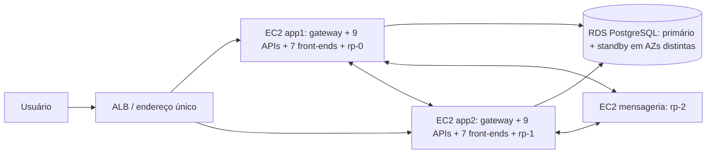

# REQUISITOS — Portal B2B Distribuído (Microsserviços + Kafka/Redpanda) — v1.0

## 0. Metadados

| Campo | Valor |
|---|---|
| Projeto | Portal B2B Distribuído |
| Versão | 1.0 |
| Data | 2026-10-20 |
| Status | APROVADO PARA A PoC E PARA O EXPERIMENTO. Pendências da seção 11 respondidas; os itens "Bloqueante p/ produção = Sim" não impedem a PoC, apenas a entrada em produção |
| Documentos-fonte | (1) Documento de requisitos e análise crítica da infraestrutura (GCP); (2) Diagrama "Arquitetura do Portal B2B Distribuído — Microsserviços + Kafka (Event-Driven)"; (3) Lista de equipes do projeto; (4) Respostas das equipes às pendências da v0.9 |
| Autor(es) | Coordenação do projeto (consolidação das respostas das equipes) |
| Revisor(es) | Grupo de Teste e Equipe de Infraestrutura (a confirmar) |

## 1. INSTRUÇÕES PARA A LLM (NÃO ALTERAR ESTE BLOCO)

**Papel.** Você é arquiteto(a) de nuvem sênior (AWS), especialista em Terraform, microsserviços, Kafka/Redpanda e DevOps, e também professor(a) capaz de explicar para quem nunca usou AWS ou Terraform.

**Tarefa.** Leia TODO este documento e gere, na pasta `/saida`, os artefatos abaixo, **em etapas**. Se a conversa permitir, execute tudo em ordem; se o limite de resposta impedir, pare ao final de cada etapa e aguarde eu escrever `PRÓXIMA ETAPA`.

| Etapa | Artefato | Conteúdo mínimo |
|---|---|---|
| 1 | `01-arquitetura-aws.md` | Visão geral; diagrama Mermaid; decisões (ADR curta com alternativas e justificativa); mapeamento **ID de requisito → recurso AWS**; segurança; observabilidade; recuperação (RTO/RPO e runbook); estimativa de custo mensal com premissas; riscos; lista de premissas assumidas (PA-xx); o que a PoC NÃO prova |
| 2 | `02-terraform/` | Código modular (`network`, `security`, `compute_app`, `compute_msg`, `rds`, `alb`, `secrets`, `observability`, `ecr`, `budgets`), um diretório por ambiente em `envs/`, `variables.tf`, `outputs.tf`, `terraform.tfvars.example`, `backend.tf.example`, scripts `user_data` e `README.md` |
| 3 | `03-guia-iniciante.md` | Passo a passo para quem nunca usou AWS/Terraform: criar conta, MFA, usuário IAM/Identity Center, AWS CLI, instalar Terraform (Windows/macOS/Linux), `init/fmt/validate/plan/apply/destroy`, como conferir se deu certo, custos, como evitar cobranças, 10 erros comuns e solução |
| 4 | `04-poc/` | PoC executável em UMA máquina com Docker Compose: `docker-compose.yml`, `Makefile`, serviços, front-ends, gateway, observabilidade, `scripts/`, `tests/`, `.env.example`, `README-poc.md` |
| 5 | `05-matriz-rastreabilidade.csv` | Colunas: `id,secao,escopo,prioridade,peso,componente_aws,artefato_terraform,artefato_poc,teste` — **uma linha para cada ID das seções 5 a 9 e 12** |

**Requisitos da PoC (Etapa 4).**
1. Deve subir com no máximo 3 comandos: `cp .env.example .env`, `make up`, `make test`.
2. Deve implementar todo requisito de escopo `LOCAL` e uma versão reduzida de todo requisito `REDUZIDO` (a seção 6 define o que "reduzido" significa em cada caso).
3. `make test` roda a suíte e grava, para cada ID, `tests/results/<ID>.json` no formato `{"id":"RF-01","status":"pass|fail|partial","evidencia":"..."}`.
4. `make conformidade` executa `scripts/calc_conformidade.py`, que lê a matriz e os resultados e imprime C (seção 13).
5. `README-poc.md` deve ter: pré-requisitos, comandos, portas, tempo esperado de subida, como interpretar os resultados, como derrubar tudo (`make down`) e solução dos 10 problemas mais prováveis.

**Regras invioláveis.**
- **R1.** Não invente requisitos. O que não estiver previsto vira premissa registrada como `PA-xx` na Etapa 1.
- **R2.** Se faltar dado, registre a premissa e continue. Não pare para perguntar.
- **R3.** Nenhum segredo real no código, nos exemplos ou nos logs. Use placeholders e `.env.example`.
- **R4.** O nome de cada teste cita o ID verificado (ex.: `test_RF_17_health`).
- **R5.** Requisitos `SOMENTE-AWS` são cobertos no Terraform e validados por `terraform fmt -check`, `validate` e `plan`. Não os simule na PoC, mas inclua-os na matriz.
- **R6.** Este documento tem precedência sobre suas preferências técnicas. Se discordar, implemente como está escrito e registre a discordância como "Objeção técnica".
- **R7.** Código completo e executável. Proibido `...`, `TODO`, pseudocódigo ou trechos "omitidos por brevidade". Se não couber, divida em etapas.
- **R8.** Versões fixas para imagens e dependências. Proibido `latest`.
- **R9.** Documentação e comentários em português do Brasil. Nomes de rotas, tópicos e eventos exatamente como neste documento.
- **R10.** Ao final de cada etapa, liste os IDs cobertos e os não cobertos (autoverificação informativa).
- **R11.** Não declare conformidade nem atribua nota a si mesmo. A medição é feita por suíte independente.
- **R12.** Segurança por padrão: containers sem root, privilégio mínimo, TLS onde a seção 8 exigir.

## 2. Contexto e objetivo

- **Problema que o sistema resolve:** conectar empresas compradoras e fornecedoras em um portal B2B que cruza ofertas com demandas, conduz a negociação (venda direta ou leilão), gera pedidos e contrata frete com transportadoras, tudo de forma desacoplada e orientada a eventos.
- **Atores / usuários:** Comprador, Fornecedor, Transportadora e Administrador (usuários humanos); e a *matching engine* (processo interno).
- **Fluxo principal (origem: diagrama):**

| Passo | Ação | Evento(s) Kafka envolvido(s) |
|---|---|---|
| 1 | Fornecedor publica fornecimento | `fornecimento_criado`, `estoque_atualizado` |
| 2 | Comprador registra demanda | `demanda_criada` (ou `demanda_recorrente_gerada`) |
| 3 | Eventos são publicados no Kafka | todos os acima |
| 4 | Matching Engine calcula oferta × demanda | (consome 1 a 3) |
| 5 | Define o modo de negociação (venda direta, leilão direto ou reverso) | `modo_negociacao_definido`, `leilao_iniciado` |
| 6 | Negociação ocorre e o vencedor é definido | `lance_realizado`, `negociacao_fechada` |
| 7 | Pedido é criado | `pedido_criado` |
| 8 | Logística é acionada para o frete | `solicitacao_frete_criada` |
| 9 | Transportadoras enviam cotações | `cotacao_recebida` |
| 10 | Frete é selecionado e a entrega é realizada | `frete_selecionado`, `pedido_atualizado` |

- **Dentro do escopo:** 9 serviços de domínio; API Gateway; 7 front-ends web; mensageria Redpanda (API Kafka) com Schema Registry; PostgreSQL em 2 servidores (primário e secundário); ferramentas administrativas (PgAdmin, Kafka UI, Uptime Kuma); observabilidade; infraestrutura AWS por Terraform; PoC local em Docker Compose.
- **Fora do escopo:** sistemas externos "futuros" do diagrama (ERP, pagamentos, BI/Analytics, notificações por e-mail/SMS); Kubernetes/EKS; implantação multirregião; aplicativo móvel; upload de arquivos no MVP; pagamento e emissão fiscal; funcionalidades do backlog BL-01 a BL-07 da seção 4.3 (D-18).
- **Glossário:**
  - **Leilão direto:** vários compradores disputam uma oferta de um fornecedor.
  - **Leilão reverso:** vários fornecedores disputam uma demanda de um comprador.
  - **Venda direta:** uma oferta compatível com uma demanda, sem disputa.
  - **DLT:** *Dead Letter Topic*, tópico para mensagens que falharam após as tentativas.
  - **RTO / RPO:** tempo máximo para restaurar o serviço / quantidade máxima de dados que se aceita perder.
  - **Ativo-ativo:** as duas VMs de aplicação recebem tráfego simultaneamente (o termo "standby" do documento-fonte é incorreto para esta arquitetura).
  - **Readiness / liveness:** a instância está pronta para receber tráfego / o processo está vivo.
  - **Servidor primário / secundário (standby):** os dois servidores PostgreSQL; o primário atende leitura e escrita, o secundário replica os dados em outra zona de disponibilidade e assume se o primário falhar.

## 3. Restrições e premissas

| ID | Restrição / premissa | Valor |
|---|---|---|
| RES-01 | Nuvem alvo | AWS. A PoC roda em máquina local com Docker Compose |
| RES-02 | Região | `us-east-1` (N. Virgínia), região de menor custo — D-08 |
| RES-03 | Orçamento mensal máximo | US$ 500 somando os ambientes ativos — D-08 |
| RES-04 | Ambientes | `local`, `integracao`, `hml`, `prod` (sem compartilhar banco, tópicos nem credenciais) |
| RES-05 | Sistema operacional dos servidores | Ubuntu Server 22.04 LTS |
| RES-06 | Runtime | Docker Engine + Docker Compose plugin em EC2. **Sem** Kubernetes — D-05 |
| RES-07 | Mensageria | Redpanda com 3 brokers (API compatível com Kafka). **Sem** Amazon MSK |
| RES-08 | Banco de dados | PostgreSQL 16 em **2 servidores** (primário + secundário em AZs distintas; RDS Multi-AZ na AWS), banco `portal_b2b`, **um schema por serviço** — D-02 |
| RES-09 | Linguagens e frameworks | Serviços: Python 3.12 + FastAPI. Front-ends: React + Vite servidos por Nginx |
| RES-10 | IaC | Terraform ≥ 1.7, provider `aws ~> 5.0`, state remoto em S3 com bloqueio de estado |
| RES-11 | Dimensionamento inicial | EC2 `t3.large` (2 vCPU, 8 GB, gp3 50 GB) para os 2 servidores de aplicação e para o servidor de mensageria. **Ponto de partida acadêmico**, a validar por medição — D-17 |
| RES-12 | Máquina mínima da PoC | 16 GB de RAM, 4 vCPU, 30 GB livres, Docker Compose v2 |
| RES-13 | Segredos | Nunca no repositório nem em imagens; em AWS, no Secrets Manager |
| RES-14 | Idioma | Português do Brasil |

## 4. Catálogo de componentes e serviços

### 4.1 Serviços de domínio (9)

| Serviço | Domínio | Porta | Prefixo da API | Schema / role DML | Front-end | Produz | Consome (premissa D-11) |
|---|---|---|---|---|---|---|---|
| `usuarios-service` | Usuários / Acesso | 8101 | `/api/v1/usuarios` | `usuarios` / `svc_usuarios` | `/usuarios/` | `empresa_cadastrada` | — |
| `produtos-service` | Produtos | 8102 | `/api/v1/produtos` | `produtos` / `svc_produtos` | `/produtos/` | `produto_cadastrado` | — |
| `fornecimentos-service` | Fornecimentos | 8103 | `/api/v1/fornecimentos` | `fornecimentos` / `svc_fornecimentos` | `/fornecimentos/` | `fornecimento_criado`, `estoque_atualizado` | `produto_cadastrado`, `empresa_cadastrada` |
| `demanda-service` | Demanda | 8104 | `/api/v1/demandas` | `demanda` / `svc_demanda` | `/demanda/` | `demanda_criada`, `demanda_recorrente_gerada` | `produto_cadastrado`, `empresa_cadastrada` |
| `mercado-service` | Mercado (Matching Engine) | 8105 | `/api/v1/mercado` | `mercado` / `svc_mercado` | `/negociacao/` (compartilhado) | `modo_negociacao_definido`, `leilao_iniciado` | `produto_cadastrado`, `fornecimento_criado`, `estoque_atualizado`, `demanda_criada`, `demanda_recorrente_gerada`, `lance_realizado` |
| `negociacao-service` | Negociação / Leilão | 8106 | `/api/v1/negociacoes` | `negociacao` / `svc_negociacao` | `/negociacao/` | `lance_realizado`, `negociacao_fechada` | `modo_negociacao_definido`, `leilao_iniciado` |
| `pedidos-service` | Pedidos | 8107 | `/api/v1/pedidos` | `pedidos` / `svc_pedidos` | `/pedidos/` | `pedido_criado`, `pedido_atualizado` | `negociacao_fechada`, `frete_selecionado` |
| `logistica-service` | Logística / Frete | 8108 | `/api/v1/logistica` | `logistica` / `svc_logistica` | `/logistica/` | `solicitacao_frete_criada`, `frete_selecionado` | `pedido_criado`, `pedido_atualizado`, `cotacao_recebida` |
| `transportadoras-service` | Transportadoras | 8109 | `/api/v1/transportadoras` | `transportadoras` / `svc_transportadoras` | `/logistica/` (compartilhado) | `cotacao_recebida` | `solicitacao_frete_criada`, `empresa_cadastrada` |

**Front-ends (7), todos React + Vite servidos por Nginx, atrás do gateway (D-06):** `/usuarios/`, `/produtos/`, `/fornecimentos/`, `/demanda/`, `/negociacao/`, `/pedidos/`, `/logistica/`.

### 4.2 Componentes de plataforma

| Componente | Função | Porta (PoC) | Equivalente AWS |
|---|---|---|---|
| Gateway (Nginx) | Endereço único, roteamento por prefixo, TLS, rate limiting, cabeçalho `X-Served-By` | 8080 (HTTP), 8443 (HTTPS) | ALB + Nginx nas EC2 |
| Balanceador local | Distribui entre `app1` e `app2` | 8080 / 8443 | ALB |
| `app1`, `app2` | Instâncias ativo-ativo (gateway local, 9 APIs, 7 front-ends, 1 broker) | — | 2 × EC2 em AZs distintas |
| Redpanda `rp-0`, `rp-1`, `rp-2` | Cluster de eventos (3 brokers) | 19092 (Kafka externo) | EC2 (`rp-0`/`rp-1` nas VMs de app; `rp-2` na VM de mensageria) |
| Schema Registry | Contratos de eventos | 18081 | Recurso embutido do Redpanda |
| `pg-primary` | PostgreSQL 16, banco `portal_b2b` (leitura e escrita) | 5432 | RDS Multi-AZ (nó primário) |
| `pg-replica` | PostgreSQL 16, réplica síncrona em streaming (standby) | 5433 | RDS Multi-AZ (nó standby em outra AZ) |
| PgAdmin | Administração do PostgreSQL | 5050 (`127.0.0.1`) | Via SSM port forwarding |
| Kafka UI | Administração do Redpanda | 8090 (`127.0.0.1`) | Via SSM port forwarding |
| Uptime Kuma | Disponibilidade | 3001 (`127.0.0.1`) | Via SSM port forwarding |
| Prometheus + Alertmanager | Métricas e alertas | 9090 / 9093 | CloudWatch Metrics/Alarms |
| Grafana | Dashboards | 3000 (`127.0.0.1`) | CloudWatch Dashboards |
| Loki + Promtail | Logs centralizados | 3100 | CloudWatch Logs |
| Jaeger + OpenTelemetry Collector | Tracing | 16686 (`127.0.0.1`) | X-Ray |
| Exporters | cAdvisor, node-exporter, postgres-exporter, kafka-exporter | — | CloudWatch Agent |



### 4.3 Equipes e propriedade

| Equipe | Integrantes | Dona de | Requisitos principais |
|---|---|---|---|
| Fornecimento e Produtos | 4 | `produtos-service`, `fornecimentos-service`; conteúdo de domínio dos front-ends `/produtos/` e `/fornecimentos/`; tópicos `produto_cadastrado`, `fornecimento_criado`, `estoque_atualizado` | RF-03, RF-04 |
| Compra e Demanda | 5 | `demanda-service`; conteúdo de domínio do front-end `/demanda/`; tópicos `demanda_criada`, `demanda_recorrente_gerada` | RF-05.1, RF-05.2 |
| Mercado, Negociação/Leilão e Pedidos | 3 | `mercado-service`, `negociacao-service`, `pedidos-service`; front-ends `/negociacao/` e `/pedidos/`; tópicos `modo_negociacao_definido`, `leilao_iniciado`, `lance_realizado`, `negociacao_fechada`, `pedido_criado`, `pedido_atualizado` | RF-06 a RF-10, CT-A06 |
| Logística/Transporte | 5 | `logistica-service`, `transportadoras-service`; front-end `/logistica/`; tópicos `solicitacao_frete_criada`, `cotacao_recebida`, `frete_selecionado` | RF-11.1, RF-11.2, RF-12 |
| Autenticação (Equipe A) | 4 | `usuarios-service`; front-end `/usuarios/`; tópico `empresa_cadastrada`; emissão e validação de JWT (biblioteca compartilhada) | RF-01, RF-02.1, RF-02.2, RNF-17, RNF-18, RNF-27 |
| Banco de Dados | 5 | Servidores `pg-primary` e `pg-replica`, schemas, roles, migrações, backup e restauração | RFI-08, RFI-08.1, RFI-08.2, RFI-09.1 a RFI-09.3, SW-06, RNF-10, RNF-38 a RNF-40 |
| Infraestrutura | 3 | Gateway, `app1`/`app2`, Redpanda, Terraform, observabilidade, deploy | RFI-01 a RFI-07, RFI-10 a RFI-16, INF-01 a INF-12, RNF-02 a RNF-05, RNF-16, RNF-19 a RNF-22, RNF-29 a RNF-37, RNF-41 a RNF-43 |
| Teste | 8 | Suíte de testes independente, medição de C, C_AWS e C_CA, relatório de resultados | RFI-12, seções 12 e 13 |
| UX/UI | 2 | Diretrizes de design dos 7 front-ends | RF-13, SW-08 |

Regras de propriedade:
- **Incidentes:** a Infraestrutura declara e encerra; o Banco de Dados responde por incidentes do PostgreSQL; a segurança é compartilhada entre Autenticação (identidade e acesso) e Infraestrutura (rede e nuvem). O **contrato de cada evento** pertence à equipe do serviço produtor (tabela da seção 9.2). A pessoa nominal (líder/plantão) é indicada por cada equipe antes da produção (D-13).
- **Independência da medição:** o Grupo de Teste mantém a suíte independente e **não** participa da execução com a LLM nem do ajuste de prompt.
- **Front-ends:** a UX/UI define as diretrizes; a implementação fica com a equipe do domínio (D-19).

**Backlog declarado pelas equipes, sem requisito formal (não entra em C; a LLM não deve implementar, conforme R1; D-18):**

| ID | Responsabilidade declarada pela equipe Compra e Demanda | Observação |
|---|---|---|
| BL-01 | Análise e previsão de demanda | Sem correspondência nos documentos-fonte |
| BL-02 | Processamento e gestão de pedidos de compra | Sobrepõe RF-09 e RF-10 (`pedidos-service`) |
| BL-03 | Controle de orçamento de compras | Sem correspondência |
| BL-04 | Relatórios e histórico de compras | Sem correspondência |
| BL-05 | Avaliação de necessidades de reposição | Sem correspondência |
| BL-06 | Acompanhamento de status de compra | Sobrepõe RF-10 |
| BL-07 | Geração de alertas de alta/baixa demanda | Sem correspondência |

As responsabilidades da equipe Fornecimento e Produtos (estoque, tipo de transporte, cadastro, categoria, quantidade, origem, preço e relação fornecedor-produto) já estão cobertas por RF-03 e RF-04.

## 5. Requisitos funcionais (RF)

Legenda: **Prio** M/S/C/W; **Escopo** `LOCAL`/`REDUZIDO`/`SOMENTE-AWS`; **Método** T (Teste), I (Inspeção), A (Análise); **Peso** 1–3.

| ID | Requisito | Prio | Escopo | Critério de aceite | Método | Peso |
|---|---|---|---|---|---|---|
| RF-01 | Cadastrar e manter empresas compradoras, fornecedoras e transportadoras, identificadas por CNPJ | M | LOCAL | Dado um CNPJ válido, quando `POST /api/v1/usuarios/empresas`, então 201, a empresa é consultável por `GET` e o evento `empresa_cadastrada` é publicado; CNPJ repetido → 409 | T | 3 |
| RF-02.1 | Gerenciar usuários vinculados a uma empresa | M | LOCAL | Dado um usuário criado, quando listado, então a senha não é retornada e está armazenada com hash (argon2 ou bcrypt); usuário desativado não autentica (401) | T | 3 |
| RF-02.2 | Gerenciar perfis (comprador, fornecedor, transportadora, admin) e suas permissões | M | LOCAL | Dado um usuário com perfil comprador, quando tenta `POST /api/v1/fornecimentos`, então 403 | T | 3 |
| RF-03 | Cadastrar e consultar o catálogo de produtos (categoria, unidade, tipo de transporte) | M | LOCAL | Dado um produto válido, quando `POST /api/v1/produtos`, então 201 e `produto_cadastrado` publicado; `GET ?categoria=X` retorna só a categoria X | T | 2 |
| RF-04 | Registrar ofertas de fornecimento e controlar o estoque disponível | M | LOCAL | Dada oferta com quantidade 100, quando uma baixa de 30 é registrada, então estoque = 70 e `estoque_atualizado` é publicado; baixa de 101 → 422 e estoque nunca negativo | T | 3 |
| RF-05.1 | Registrar demanda de compra pontual | M | LOCAL | Dados produto e quantidade válidos, quando `POST /api/v1/demandas`, então 201 e `demanda_criada` publicado | T | 2 |
| RF-05.2 | Registrar demanda de compra recorrente e gerar demandas a cada ciclo | S | REDUZIDO | Versão reduzida: frequência em segundos. Dada frequência de 10 s, quando decorridos 30 s, então ≥ 2 eventos `demanda_recorrente_gerada` | T | 2 |
| RF-06 | Cruzar demandas com ofertas compatíveis | M | REDUZIDO | Versão reduzida: regra simples (mesmo produto, quantidade ofertada ≥ demandada, preço ≤ teto quando informado). Dados oferta e demanda compatíveis, então em ≤ 5 s existe um *match*; incompatíveis → 0 *matches* | T | 3 |
| RF-07 | Determinar o tipo de negociação (venda direta, leilão direto ou leilão reverso) | M | REDUZIDO | Regra (D-10): 1 oferta × 1 demanda = venda direta; 1 oferta × N demandas = leilão direto; 1 demanda × N ofertas = leilão reverso. Publica `modo_negociacao_definido` e, se leilão, `leilao_iniciado` | T | 2 |
| RF-08 | Registrar negociações, propostas e lances e definir o vencedor | M | LOCAL | Dado um leilão direto, quando um lance ≤ lance atual é enviado, então 409; com lance maior, 201 e `lance_realizado`; ao encerrar, o maior lance vence e `negociacao_fechada` é publicado (menor lance em leilão reverso) | T | 3 |
| RF-09 | Gerar pedido a partir de negociação concluída | M | LOCAL | Dado `negociacao_fechada`, então existe exatamente 1 pedido por `negociacaoId`, mesmo com o evento reentregue, e `pedido_criado` é publicado | T | 3 |
| RF-10 | Permitir o acompanhamento do ciclo de vida do pedido | M | LOCAL | Estados `CRIADO → AGUARDANDO_FRETE → FRETE_SELECIONADO → ENTREGUE` (ou `CANCELADO`). `GET /api/v1/pedidos/{id}/historico` lista as transições com data; transição inválida → 409; cada transição publica `pedido_atualizado` | T | 2 |
| RF-11.1 | Solicitar frete para um pedido criado | M | LOCAL | Dado `pedido_criado`, então a logística registra a solicitação e publica `solicitacao_frete_criada`; o pedido vai a `AGUARDANDO_FRETE` | T | 2 |
| RF-11.2 | Receber cotações logísticas das transportadoras | M | LOCAL | Dada uma solicitação, quando duas transportadoras cadastradas (seed) respondem, então há ≥ 2 `cotacao_recebida` em ≤ 10 s, com preço e prazo | T | 2 |
| RF-12 | Selecionar o frete aplicável ao pedido | M | LOCAL | Dadas ≥ 2 cotações, quando a seleção é feita (regra padrão: menor preço, desempate por menor prazo), então exatamente 1 cotação fica `selecionada`, `frete_selecionado` é publicado e o pedido vai a `FRETE_SELECIONADO` | T | 2 |
| RF-13 | Disponibilizar interfaces web para todos os domínios | S | REDUZIDO | Versão reduzida: cada um dos 7 front-ends lista e cria a entidade principal do domínio. Dado o subcaminho, então HTTP 200 e a listagem carrega dados da API | T | 2 |
| RF-14 | Publicar eventos de negócio para integração entre microsserviços | M | LOCAL | Dado qualquer ação que gere evento (seção 9.2), então a mensagem aparece no tópico correto, com o envelope completo | T | 3 |
| RF-15 | Rastrear o fluxo distribuído por `correlationId` | M | LOCAL | Dado um `X-Correlation-Id` na entrada, então o mesmo valor aparece nos eventos e nos logs de ≥ 3 serviços ao longo do fluxo; se ausente, o gateway gera um | T | 3 |
| RF-16 | Disponibilizar documentação Swagger/OpenAPI de todas as APIs | M | LOCAL | Dado cada um dos 9 serviços, então `GET /docs` e `GET /openapi.json` retornam 200 | T | 2 |
| RF-17 | Disponibilizar endpoint de saúde em cada microsserviço | M | LOCAL | Dado cada serviço, então `GET /health` retorna 200 com JSON `{"status":"UP"}` | T | 3 |
| RF-18 | Executar o fluxo principal de negócio ponta a ponta (passos 1 a 10 da seção 2) | M | LOCAL | Dado o ambiente no ar, quando um script cria empresa, produto, fornecimento e demanda, então em ≤ 60 s o pedido chega a `FRETE_SELECIONADO`, sem outra intervenção | T | 3 |

## 6. Requisitos de infraestrutura e plataforma

### 6.1 Infraestrutura funcional (RFI)

| ID | Requisito | Prio | Escopo | Critério de aceite | Método | Peso |
|---|---|---|---|---|---|---|
| RFI-01 | Fornecer um endereço único de entrada para interfaces web e APIs | M | REDUZIDO | Versão reduzida: `http(s)://localhost:8080/8443` no lugar do ALB. Dado o endereço único, então `/api/...` e os 7 subcaminhos respondem; as portas 8101–8109 não ficam publicadas no host | T | 3 |
| RFI-02 | Balancear as requisições entre pelo menos duas instâncias da aplicação | M | REDUZIDO | Versão reduzida: `app1` e `app2` em Compose, balanceador local. Dadas 40 requisições, então cada instância atende ≥ 30% (cabeçalho `X-Served-By`) | T | 3 |
| RFI-03 | Retirar automaticamente instâncias indisponíveis da distribuição de tráfego | M | REDUZIDO | Dado que `app1` para (ou que um de seus serviços falha), quando passam ≤ 30 s, então 0 respostas 5xx pelo endereço único e todo o tráfego vai a `app2` | T | 3 |
| RFI-04 | Rotear cada prefixo de API para o microsserviço correspondente | M | LOCAL | Dados os 9 prefixos da seção 4.1, então cada um responde com `X-Service-Name` igual ao serviço esperado | T | 3 |
| RFI-05 | Publicar os front-ends em subcaminhos definidos | M | LOCAL | Dados os 7 subcaminhos, então 200 com HTML e os ativos (JS/CSS) carregam sob o subcaminho (`base` do Vite) | T | 2 |
| RFI-06 | Fornecer mensageria compatível com a API Kafka | M | LOCAL | Dado um cliente Kafka padrão (`rpk` ou `kcat`) em `localhost:19092`, então produz e consome em um tópico | T | 3 |
| RFI-07 | Manter os eventos replicados entre os nós do cluster | M | REDUZIDO | Versão reduzida: 3 brokers no mesmo host. Dados todos os tópicos de negócio, então fator de replicação = 3 e ISR = 3 | T | 3 |
| RFI-08 | Fornecer PostgreSQL acessível por todas as instâncias autorizadas | M | LOCAL | Dadas `app1` e `app2`, então os 9 serviços de ambas executam uma consulta ao banco `portal_b2b` no servidor primário | T | 3 |
| RFI-08.1 | Manter 2 servidores PostgreSQL (primário e secundário) com replicação síncrona | M | REDUZIDO | Versão reduzida: 2 containers (`pg-primary`, `pg-replica`) com replicação em streaming síncrona (equivalente local do Multi-AZ). Dado o primário, então `pg_stat_replication` mostra a réplica em `sync`, uma linha gravada no primário aparece na réplica em ≤ 5 s e a réplica rejeita escrita | T | 3 |
| RFI-08.2 | Promover o servidor secundário quando o primário falhar | M | REDUZIDO | Versão reduzida: `scripts/promote_replica.sh`. Dado que `pg-primary` para, quando o script é executado, então a réplica passa a primária e os serviços voltam a gravar em ≤ 60 s (mecanismo de reconexão à escolha: HAProxy, PgBouncer ou alias de rede); nenhuma linha confirmada antes da queda se perde | T | 3 |
| RFI-09.1 | Segregar a credencial de administração do banco | M | LOCAL | Dada a role `portal_admin`, então ela não aparece em nenhum `.env`/ambiente de serviço e só as ferramentas administrativas a usam | I | 2 |
| RFI-09.2 | Segregar a credencial de DDL do banco | M | LOCAL | Dada a role `portal_ddl`, então só o job de migração a usa; a role de runtime tenta `CREATE TABLE` e recebe `permission denied` | T | 2 |
| RFI-09.3 | Usar uma credencial DML por microsserviço, limitada ao próprio schema | M | LOCAL | Dada `svc_pedidos`, quando faz `SELECT` em `mercado.*`, então `permission denied`; no schema `pedidos` faz SELECT/INSERT/UPDATE/DELETE | T | 3 |
| RFI-10 | Executar todos os componentes de aplicação em containers | M | LOCAL | Dado `docker compose ps`, então todos os componentes de aplicação, mensageria e ferramentas estão `running`; nenhum roda fora de container | I | 3 |
| RFI-11 | Automatizar o deploy nas duas instâncias de aplicação | S | REDUZIDO | Versão reduzida: `scripts/deploy.sh` sobe `app1` e `app2` (projetos Compose). Dado o comando, então `/health/ready` retorna 200 nas duas sem passo manual | T | 2 |
| RFI-12 | Permitir verificação automatizada da infraestrutura e dos serviços | M | LOCAL | Dado `make test`, então gera `tests/results/<ID>.json` e o código de saída é ≠ 0 se algum teste falhar | T | 2 |
| RFI-13.1 | Disponibilizar ferramenta administrativa para PostgreSQL (PgAdmin) | S | LOCAL | Dado `http://127.0.0.1:5050`, então exige login e já lista os servidores `pg-primary` e `pg-replica` | T | 1 |
| RFI-13.2 | Disponibilizar ferramenta administrativa para Kafka (Kafka UI) | S | LOCAL | Dado `http://127.0.0.1:8090`, então lista 3 brokers e os 15 tópicos de negócio | T | 1 |
| RFI-14 | Centralizar configurações variáveis fora do código-fonte | M | LOCAL | Dado o código, então nenhum host, senha ou porta de dependência está fixo (busca por padrões); tudo vem de variáveis de ambiente | I | 2 |
| RFI-15 | Permitir atualização consistente das duas VMs | S | REDUZIDO | Versão reduzida: `scripts/rolling_update.sh <versao>` atualiza `app1` e depois `app2`, aguardando `/health/ready`. Dada carga de 10 req/s, então 0 respostas 5xx e `GET /version` igual nas duas | T | 2 |
| RFI-16 | Reiniciar automaticamente containers após falha ou reinicialização do host | M | LOCAL | Dado `docker kill` em um container de serviço, então volta a `healthy` em ≤ 60 s; política `unless-stopped` ativa | T | 2 |

### 6.2 Infraestrutura em nuvem (INF) — validável por Terraform

| ID | Requisito | Prio | Escopo | Critério de aceite | Método | Peso |
|---|---|---|---|---|---|---|
| INF-01 | Provisionar uma VPC privada com sub-redes públicas e privadas em ≥ 2 AZs | M | SOMENTE-AWS | O plano contém `aws_vpc` e ≥ 4 `aws_subnet` (2 públicas, 2 privadas) em AZs distintas | I | 3 |
| INF-02 | Definir Security Groups por função (alb, app, msg, rds) com origem e porta explícitas | M | SOMENTE-AWS | Nenhuma regra de entrada `0.0.0.0/0`, exceto 80/443 no ALB; nenhuma regra para a porta 22; RDS só aceita origem do SG `app` | I | 3 |
| INF-03 | Provisionar ALB com health check profundo, HTTP→HTTPS e DNS estável | M | SOMENTE-AWS | O plano contém `aws_lb`, listener 443 com certificado ACM, listener 80 com redirecionamento e target group com `health_check.path = "/health/ready"`; DNS por Route 53 (D-04) | I | 3 |
| INF-04 | Provisionar 2 EC2 de aplicação em AZs distintas, atrás do ALB | M | SOMENTE-AWS | O plano contém 2 `aws_instance` `t3.large` Ubuntu 22.04, gp3 50 GB criptografado, em sub-redes privadas de AZs distintas, ambas registradas no target group | I | 3 |
| INF-05 | Provisionar 1 EC2 de mensageria para o broker `rp-2` | M | SOMENTE-AWS | O plano contém 1 `aws_instance` `t3.large`, gp3 50 GB, em sub-rede privada, com SG `msg` | I | 3 |
| INF-06 | Provisionar os 2 servidores PostgreSQL 16 (RDS Multi-AZ: primário + standby em AZs distintas) sem acesso público | M | SOMENTE-AWS | O plano contém `aws_db_instance` com `engine_version = "16.x"`, `multi_az = true`, `publicly_accessible = false`, `storage_encrypted = true`, `max_allocated_storage` definido e `backup_retention_period = 7` | I | 3 |
| INF-07 | Restringir o acesso administrativo ao SSM Session Manager | M | SOMENTE-AWS | Instâncias sem `key_name` e com perfil que inclui `AmazonSSMManagedInstanceCore`; nenhuma regra de entrada na porta 22 | I | 3 |
| INF-08 | Aplicar privilégio mínimo ao IAM das instâncias | M | SOMENTE-AWS | Os perfis das instâncias só permitem ler os segredos do próprio ambiente, enviar logs/métricas e baixar imagens do ECR; sem `*:*` | I | 2 |
| INF-09 | Provisionar ECR com varredura e tags imutáveis | S | SOMENTE-AWS | O plano contém `aws_ecr_repository` com `image_scanning_configuration.scan_on_push = true` e `image_tag_mutability = "IMMUTABLE"` | I | 2 |
| INF-10 | Provisionar alerta de orçamento | S | SOMENTE-AWS | O plano contém `aws_budgets_budget` com notificação em 80% do valor de RES-03 | I | 1 |
| INF-11 | Parametrizar o Terraform por ambiente, com state remoto separado e tags padrão | M | SOMENTE-AWS | Existem `envs/integracao`, `envs/hml` e `envs/prod`, cada um com seu `backend` e variáveis; todos os recursos têm tags `Projeto`, `Ambiente`, `Responsavel`; `terraform validate` passa em cada um | I | 2 |
| INF-12 | Provisionar as VMs com o software base | M | SOMENTE-AWS | O `user_data` instala Docker Engine, Docker Compose plugin, Git, AWS CLI, cliente `psql`, `chrony` (NTP) e `unattended-upgrades` | I | 2 |

## 7. Requisitos de software (SW)

| ID | Requisito | Prio | Escopo | Critério de aceite | Método | Peso |
|---|---|---|---|---|---|---|
| SW-01 | Entregar um `Dockerfile` por serviço, com build em múltiplos estágios e usuário não root | M | LOCAL | Dado cada serviço e front-end, então `docker build` conclui e `docker inspect` mostra usuário diferente de root | T | 2 |
| SW-02 | Entregar um `docker-compose.yml` por serviço e um agregador na raiz | M | LOCAL | Dado `docker compose config` em cada arquivo, então válido, e o compose da raiz sobe o conjunto | T | 2 |
| SW-03 | Entregar `.env.example` sem segredos reais | M | LOCAL | Dado cada `.env.example`, então só contém placeholders; `.env` está no `.gitignore` | I | 2 |
| SW-04 | Fazer cada aplicação escutar em `0.0.0.0` na porta oficial da seção 4.1 | M | LOCAL | Dado cada serviço, então responde na porta oficial a partir de outro container | T | 2 |
| SW-05 | Declarar `restart: unless-stopped` em todos os containers de longa duração | M | LOCAL | Dado o compose resolvido, então todo serviço de longa duração tem a política | I | 1 |
| SW-06 | Versionar as migrações de banco por serviço, executadas por job com a role DDL | M | LOCAL | Dado cada serviço, então há pasta de migrações versionadas (Alembic ou equivalente) e o job `migrate` roda com `portal_ddl`, não no startup da API | T | 2 |
| SW-07 | Enviar logs a stdout/stderr em JSON | M | LOCAL | Dada uma requisição, então o log contém `timestamp`, `level`, `service`, `correlationId` e `message` | T | 2 |
| SW-08 | Construir os front-ends em React/Vite e servi-los por Nginx | S | REDUZIDO | Versão reduzida: uma página mínima por domínio. Dado cada front-end, então a imagem final é Nginx servindo o build estático | I | 1 |

## 8. Requisitos não funcionais (RNF)

O documento-fonte não trazia valores numéricos. Os valores abaixo foram definidos pelo autor por delegação da equipe e a seção 8 foi aprovada (D-07). Devem ser reavaliados após as medições em `hml`.

| ID | Categoria | Requisito (métrica) | Meta | Medição | Prio | Escopo | Peso |
|---|---|---|---|---|---|---|---|
| RNF-01 | Disponibilidade | Disponibilidade mensal | ≥ 99,5% (≈ 3 h 36 min/mês) | Métricas do ALB e CloudWatch | S | SOMENTE-AWS | 2 |
| RNF-02 | Disponibilidade | Tempo máximo de detecção de instância com falha | ≤ 15 s (intervalo 5 s × 3 falhas) | Derrubar `app1` e medir o tempo até sair do balanceamento | M | REDUZIDO | 3 |
| RNF-03 | Disponibilidade | Tempo máximo de failover | ≤ 30 s e 0 respostas 5xx depois disso | Derrubar `app1` sob 10 req/s e contar erros | M | REDUZIDO | 3 |
| RNF-04 | Disponibilidade | Falhas toleradas | 1 servidor de aplicação **ou** 1 broker **ou** 1 servidor de banco, um tipo de falha por vez | Teste de caos individual para cada tipo | M | REDUZIDO | 3 |
| RNF-05 | Disponibilidade | Health check profundo: `/health/live` (processo) e `/health/ready` (banco, Kafka e os 9 serviços da instância) | Instância inelegível ≤ 15 s após falha de qualquer serviço essencial | Parar 1 serviço de `app1` e verificar a retirada | M | REDUZIDO | 3 |
| RNF-06 | Desempenho | Latência p95 de leitura (GET) | ≤ 500 ms a 50 req/s na PoC (100 req/s na AWS); carga de referência de 200 usuários simultâneos | k6, 5 min | M | REDUZIDO | 2 |
| RNF-07 | Desempenho | Latência p95 de escrita (POST/PUT) | ≤ 1000 ms a 15 req/s na PoC (30 req/s na AWS) | k6, 5 min | S | REDUZIDO | 2 |
| RNF-08 | Desempenho | Propagação de evento (publicação até efeito no consumidor) | p95 ≤ 2 s | Timestamp do evento × timestamp do efeito | M | LOCAL | 2 |
| RNF-09 | Desempenho | Taxa de erro 5xx sob carga | ≤ 1% | k6 | M | REDUZIDO | 2 |
| RNF-10 | Desempenho | Conexões ao PostgreSQL | Pool máx. 5 por instância de serviço; total ≤ 90 (9 × 2 × 5), abaixo do limite de 100 | Inspeção da configuração e `pg_stat_activity` | S | LOCAL | 2 |
| RNF-11 | Desempenho | Limite de payload | Corpo HTTP ≤ 1 MB (acima → 413); evento ≤ 256 KB; tamanho médio de evento ≈ 2 KB | Teste | S | LOCAL | 1 |
| RNF-12 | Escalabilidade | Serviços stateless | Sem sessão em memória/disco; recriar o container não invalida o token | Recriar container e reutilizar o token | M | LOCAL | 2 |
| RNF-13 | Escalabilidade | Consumidores em grupo | 2 consumidores do mesmo `group.id` dividem as partições e cada evento é processado 1 vez por grupo | Teste com 2 réplicas | M | LOCAL | 2 |
| RNF-14 | Escalabilidade | Adicionar instância sem alterar código | `app3` entra no balanceamento e consome, apenas com configuração | `docker compose up --scale` ou projeto extra | S | REDUZIDO | 1 |
| RNF-15 | Escalabilidade | Arquivos fora do disco local | Sem upload no MVP (D-09): serviços não gravam dados de negócio em disco local e os containers de serviço não montam volumes graváveis (exceto `/tmp`) | Inspeção do compose | C | LOCAL | 1 |
| RNF-16 | Segurança | TLS no endereço único | TLS ≥ 1.2; HTTP responde 301 para HTTPS (PoC: certificado autoassinado; AWS: ACM) | `curl -k` e inspeção de redirecionamento | M | REDUZIDO | 2 |
| RNF-17 | Segurança | Autenticação por JWT | Access token 15 min; refresh token 8 h; token expirado → 401 | Teste com token expirado | M | LOCAL | 3 |
| RNF-18 | Segurança | Autorização por papéis (RBAC) | Matriz perfil × endpoint aplicada; acesso negado → 403 | Teste por perfil | M | LOCAL | 3 |
| RNF-19 | Segurança | Gestão centralizada de segredos | Segredos no AWS Secrets Manager; instâncias os leem em runtime via IAM; nenhuma senha em `user_data` | Inspeção do plano | M | SOMENTE-AWS | 2 |
| RNF-20 | Segurança | Criptografia em trânsito | PostgreSQL com `sslmode=require`; Redpanda com listeners TLS e SASL/SCRAM-SHA-256 (PoC com certificados autoassinados) | Tentar conexão sem TLS → recusada | S | REDUZIDO | 2 |
| RNF-21 | Segurança | Proteção das ferramentas administrativas | PgAdmin, Kafka UI e Uptime Kuma exigem login e escutam só em `127.0.0.1` (AWS: acesso por SSM port forwarding, sem regra pública) | Acesso externo recusado | M | LOCAL | 3 |
| RNF-22 | Segurança | WAF | AWS WAF no ALB com regras gerenciadas (Common e Known Bad Inputs) | Inspeção do plano | S | SOMENTE-AWS | 1 |
| RNF-23 | Segurança | Rate limiting | Máx. 100 req/s por IP com *burst* 50; excedente → 429 | Enviar 300 requisições em 1 s e contar 429 | S | LOCAL | 2 |
| RNF-24 | Segurança | Trilha de auditoria | Operações sensíveis (empresa, usuário, perfil, status de pedido, seleção de frete) gravam registro (quem, quando, o quê, `correlationId`); a role DML não pode alterar/apagar a tabela de auditoria | Teste de gravação e de bloqueio | S | REDUZIDO | 2 |
| RNF-25 | Segurança | Rotação de credenciais | Credencial do RDS com rotação ≤ 90 dias | Inspeção do plano | S | SOMENTE-AWS | 1 |
| RNF-26 | Segurança | Análise de vulnerabilidades de imagens | 0 vulnerabilidades CRITICAL (Trivy); AWS: `scan_on_push` | Executar Trivy | S | REDUZIDO | 2 |
| RNF-27 | Segurança | Conformidade com a LGPD | Inventário dos dados pessoais (nome e e-mail de usuários) documentado; endpoint de anonimização de usuário; logs sem e-mail e sem senha | Teste e inspeção | S | REDUZIDO | 2 |
| RNF-28 | Segurança | Proteção contra imagens comprometidas | Todas as imagens com versão fixa (sem `latest`), de fontes oficiais | Busca no compose | S | LOCAL | 1 |
| RNF-29 | Observabilidade | Logs centralizados | PoC: Loki + Promtail; AWS: CloudWatch Logs. Consulta por `correlationId` retorna logs de ≥ 3 serviços | Consulta no Loki | M | REDUZIDO | 3 |
| RNF-30 | Observabilidade | Métricas de CPU, memória, disco e rede | Visíveis no Grafana (cAdvisor e node-exporter); AWS: CloudWatch Agent | Inspeção do dashboard | S | REDUZIDO | 2 |
| RNF-31 | Observabilidade | Métricas por serviço e endpoint | `/metrics` (Prometheus) com latência (histograma) e taxa de erro por rota | `GET /metrics` | M | LOCAL | 2 |
| RNF-32 | Observabilidade | Tracing distribuído | OpenTelemetry; um trace cobre ≥ 3 serviços no fluxo ponta a ponta (PoC: Jaeger; AWS: X-Ray) | Consultar o trace | S | REDUZIDO | 2 |
| RNF-33 | Observabilidade | Consumer lag do Kafka | Métrica por grupo; alerta se lag > 1000 por 2 min | Consultar a métrica e a regra | S | REDUZIDO | 2 |
| RNF-34 | Observabilidade | Métricas e conexões do PostgreSQL | `postgres_exporter` expõe conexões ativas e o máximo | Consultar a métrica | S | REDUZIDO | 1 |
| RNF-35 | Observabilidade | Alertas automáticos | Regra "serviço fora > 30 s" dispara no Alertmanager (AWS: CloudWatch Alarm → SNS) | Parar um serviço e verificar o alerta | S | REDUZIDO | 2 |
| RNF-36 | Observabilidade | Retenção e proteção dos logs | 30 dias nos log groups, criptografados | Inspeção do plano | S | SOMENTE-AWS | 1 |
| RNF-37 | Recuperação | RTO | ≤ 60 min | Exercício de recuperação em `hml` | M | SOMENTE-AWS | 2 |
| RNF-38 | Recuperação | RPO | ≤ 5 min, com *point-in-time recovery* do RDS | Inspeção do plano | M | SOMENTE-AWS | 2 |
| RNF-39 | Recuperação | Retenção de backups | 7 dias, automáticos | Inspeção do plano | M | SOMENTE-AWS | 2 |
| RNF-40 | Recuperação | Teste de restauração | `pg_dump` → restauração em banco novo; contagem de linhas idêntica em todas as tabelas | Script de restauração | M | REDUZIDO | 3 |
| RNF-41 | Recuperação | Runbook de recuperação | Documento com a ordem rede → RDS → Redpanda → apps → gateway, reconstrução de VMs, recuperação do Kafka e responsável por declarar/encerrar incidentes | Inspeção do documento da Etapa 1 | S | SOMENTE-AWS | 1 |
| RNF-42 | Mensageria | Durabilidade de eventos | Produtores com `acks=all` e `enable.idempotence=true`; `min.insync.replicas=2`; replicação 3 | Derrubar 1 broker durante a produção: 0 eventos perdidos | M | REDUZIDO | 3 |
| RNF-43 | Mensageria | Retenção de tópicos | 7 dias (`retention.ms=604800000`); DLT 14 dias | `rpk topic describe` | S | LOCAL | 1 |

## 9. Contratos

### 9.1 API REST (CT-A)

| ID | Requisito | Prio | Escopo | Critério de aceite | Método | Peso |
|---|---|---|---|---|---|---|
| CT-A01 | Versionar as APIs em `/api/v1/...` | M | LOCAL | Dada rota sem versão, então 404; todas as rotas de negócio começam por `/api/v1/` | T | 2 |
| CT-A02 | Usar convenção uniforme de códigos HTTP | M | LOCAL | 200 leitura, 201 criação, 204 sem corpo, 400 requisição malformada, 401 não autenticado, 403 sem permissão, 404 inexistente, 409 conflito, 422 validação, 429 limite excedido | T | 1 |
| CT-A03 | Padronizar o modelo de erro (RFC 7807) | M | LOCAL | Dado qualquer erro, então `application/problem+json` com `type`, `title`, `status`, `detail`, `instance` e `correlationId` | T | 2 |
| CT-A04 | Validar a entrada de todas as rotas de escrita | M | LOCAL | Dado payload inválido, então 422 com a lista de campos inválidos | T | 2 |
| CT-A05 | Oferecer paginação, filtros e ordenação nas listagens | S | LOCAL | Dado `?page=1&size=10&sort=campo,asc`, então ≤ 10 itens ordenados; `size` > 100 → 422 | T | 2 |
| CT-A06 | Garantir idempotência em operações críticas | M | LOCAL | Dado o mesmo `Idempotency-Key` em `POST` de pedido, lance ou seleção de frete, enviado 2 vezes, então 1 único efeito e resposta idêntica | T | 3 |
| CT-A07 | Definir timeouts | S | LOCAL | Gateway → serviço 30 s; chamada entre serviços 5 s; estouro → 504 | T | 1 |
| CT-A08 | Manter compatibilidade retroativa dentro de `/v1` | C | REDUZIDO | Versão reduzida: comparação de OpenAPI (`openapi-diff`) entre duas versões simuladas; sem mudança incompatível em `/v1` | T | 1 |

### 9.2 Eventos (CT-E)

**Envelope obrigatório** (`eventType` é igual ao nome do tópico):

```json
{
  "eventId": "uuid",
  "eventType": "pedido_criado",
  "eventVersion": "1.0",
  "timestamp": "ISO-8601",
  "source": "pedidos-service",
  "correlationId": "uuid",
  "aggregateId": "id-do-pedido",
  "payload": {}
}
```

| ID | Requisito | Prio | Escopo | Critério de aceite | Método | Peso |
|---|---|---|---|---|---|---|
| CT-E01 | Publicar todo evento no envelope padrão, validado por JSON Schema | M | LOCAL | Dado um evento publicado, então contém os 8 campos e valida contra o schema registrado | T | 3 |
| CT-E02 | Usar o `aggregateId` como chave de partição | M | LOCAL | Dados 2 eventos da mesma entidade, então ficam na mesma partição | T | 2 |
| CT-E03 | Preservar a ordem por chave | S | LOCAL | Dados N eventos da mesma chave produzidos em ordem, então são consumidos na mesma ordem | T | 2 |
| CT-E04 | Garantir idempotência no consumidor | M | LOCAL | Dado o mesmo `eventId` reentregue, então 0 efeitos duplicados (tabela `processed_events` por serviço) | T | 3 |
| CT-E05 | Aplicar política de retry | M | LOCAL | Dado um consumidor que falha, então 3 tentativas com intervalos de 1 s, 2 s e 4 s antes do DLT | T | 2 |
| CT-E06 | Enviar mensagens não processáveis ao Dead Letter Topic | M | LOCAL | Dada falha após as tentativas, então a mensagem vai a `<servico>.dlt` com cabeçalhos do erro e o consumo continua | T | 2 |
| CT-E07 | Usar Schema Registry com compatibilidade retroativa | S | REDUZIDO | Versão reduzida: Schema Registry embutido do Redpanda. Os 15 schemas JSON estão registrados com compatibilidade `BACKWARD` | T | 2 |
| CT-E08 | Definir o dono de cada contrato | S | LOCAL | Cada tópico tem serviço proprietário na tabela abaixo e no `CONTRACTS.md` | I | 1 |
| CT-E09 | Criar os 15 tópicos de negócio com 3 partições | M | REDUZIDO | Versão reduzida: job de inicialização no cluster local de 3 brokers. Dado o cluster, então existem exatamente 15 tópicos de negócio, cada um com 3 partições | T | 3 |

**Catálogo de tópicos (15).** Os 13 primeiros constam do diagrama; os 2 últimos são premissa D-03. Consumidores: premissa D-11. Retenção: RNF-43.

| Tópico | Produtor (dono) | Consumidores | Chave de partição | Partições | Replicação |
|---|---|---|---|---|---|
| `empresa_cadastrada` | usuarios | fornecimentos, demanda, transportadoras | `empresaId` | 3 | 3 |
| `produto_cadastrado` | produtos | fornecimentos, demanda, mercado | `produtoId` | 3 | 3 |
| `fornecimento_criado` | fornecimentos | mercado | `fornecimentoId` | 3 | 3 |
| `estoque_atualizado` | fornecimentos | mercado | `fornecimentoId` | 3 | 3 |
| `demanda_criada` | demanda | mercado | `demandaId` | 3 | 3 |
| `demanda_recorrente_gerada` | demanda | mercado | `demandaRecorrenteId` | 3 | 3 |
| `modo_negociacao_definido` | mercado | negociacao | `negociacaoId` | 3 | 3 |
| `leilao_iniciado` | mercado | negociacao | `negociacaoId` | 3 | 3 |
| `lance_realizado` | negociacao | mercado | `negociacaoId` | 3 | 3 |
| `negociacao_fechada` | negociacao | pedidos | `negociacaoId` | 3 | 3 |
| `pedido_criado` | pedidos | logistica | `pedidoId` | 3 | 3 |
| `pedido_atualizado` | pedidos | logistica | `pedidoId` | 3 | 3 |
| `solicitacao_frete_criada` | logistica | transportadoras | `solicitacaoFreteId` | 3 | 3 |
| `cotacao_recebida` | transportadoras | logistica | `solicitacaoFreteId` | 3 | 3 |
| `frete_selecionado` | logistica | pedidos | `pedidoId` | 3 | 3 |

Tópicos DLT: um por serviço consumidor (`<servico>.dlt`), fora da contagem dos 15.

## 10. Ambientes e modelo de dados

### 10.1 Ambientes

| Ambiente | Finalidade | Características | Compartilha recursos com outro? |
|---|---|---|---|
| `local` | Trabalho individual e PoC | Docker Compose, PostgreSQL e Redpanda locais | Não |
| `integracao` | Integração entre os 9 domínios | Infraestrutura AWS compartilhada pela equipe e dados de teste | Não |
| `hml` | Testes funcionais, segurança, desempenho e recuperação | Configuração próxima da produção | Não |
| `prod` | Uso oficial | HTTPS, RDS Multi-AZ, backups, alertas e controles rígidos | Não |

Em laboratório acadêmico, apenas um ambiente AWS precisa ser aplicado por vez (D-14); o Terraform deve existir para os três.

### 10.2 Entidades principais por serviço

| Serviço / schema | Entidades e campos-chave |
|---|---|
| usuarios | `empresa(id, cnpj único, razao_social, tipo, ativo)`, `usuario(id, empresa_id, email único, senha_hash, perfil, ativo)`, `audit_log`, `processed_events` |
| produtos | `produto(id, nome, categoria, unidade, tipo_transporte)`, `processed_events` |
| fornecimentos | `fornecimento(id, fornecedor_id, produto_id, preco, quantidade_disponivel, origem)`, `movimento_estoque`, `processed_events` |
| demanda | `demanda(id, comprador_id, produto_id, quantidade, preco_teto, tipo, frequencia_segundos, proxima_execucao)`, `processed_events` |
| mercado | `match(id, demanda_id, fornecimento_id, status)`, `modo_negociacao(id, match_id, modo)`, `processed_events` |
| negociacao | `negociacao(id, modo, status, vencedor_id, valor_final)`, `lance(id, negociacao_id, empresa_id, valor, criado_em)`, `idempotency_keys`, `processed_events` |
| pedidos | `pedido(id, negociacao_id único, status)`, `pedido_item`, `pedido_historico`, `idempotency_keys`, `audit_log`, `processed_events` |
| logistica | `solicitacao_frete(id, pedido_id, status)`, `cotacao(id, solicitacao_id, transportadora_id, preco, prazo_dias, selecionada)`, `idempotency_keys`, `processed_events` |
| transportadoras | `transportadora(id, empresa_id)`, `regra_cotacao(id, transportadora_id, preco_base, prazo_dias)`, `processed_events` |

Regra de dados: cada serviço é dono do seu schema e **não** acessa tabelas de outro; a integração é por API ou evento.

## 11. Pendências, divergências e premissas

| ID | Tipo | Descrição | Decisão / premissa adotada | Impacto | Responsável | Bloqueante p/ produção? | Status |
|---|---|---|---|---|---|---|---|
| D-01 | Divergência | O diagrama mostra 9 domínios; o documento-fonte falava em 8 | **9 serviços** (seção 4.1); CA-01 usa 9 | RF, RFI, RNF-10, CA-01 | Coordenação do projeto | Não | Resolvida (confirmado: são 9 domínios) |
| D-02 | Divergência | Banco por serviço (diagrama) × banco único (documento-fonte). Resposta recebida: "2 servidores de banco de dados e 2 servidores de aplicação" | **2 servidores de aplicação** (`app1`, `app2`, ativo-ativo) e **2 servidores de banco = primário + standby** com replicação síncrona em AZs distintas (RDS Multi-AZ). Banco lógico único `portal_b2b`, 1 schema e 1 role DML por serviço | RFI-08, RFI-08.1, RFI-08.2, RFI-09.3, INF-06, RNF-04, CA-14 | Banco de Dados | Não | Resolvida (interpretação assumida: primário + standby; confirmar se os 2 servidores deveriam dividir os domínios) |
| D-03 | Divergência | 13 eventos no diagrama × 15 tópicos no documento-fonte | **15 tópicos** (inclui `cotacao_recebida` e `frete_selecionado`) | CT-E09, RF-11.2, RF-12 | Infraestrutura | Não | Resolvida (confirmado) |
| D-04 | Divergência | Exigência de "IP público estático" × ALB sem IP fixo | DNS estável (Route 53 → ALB); NLB + Elastic IP ou Global Accelerator só se IP fixo virar exigência formal | RFI-01, INF-03 | Infraestrutura | Não | Resolvida (OK) |
| D-05 | Divergência | Kubernetes e ELK no diagrama × Docker em VMs no documento-fonte | Docker Compose em EC2; Loki no lugar de ELK; Kubernetes fora do escopo | RES-06, RNF-29 | Infraestrutura | Não | Resolvida (OK) |
| D-06 | Divergência | 1 front-end no diagrama × 7 no documento-fonte | **7 front-ends** por subcaminho, agrupados conforme a seção 4.1 | RF-13, RFI-05 | UX/UI | Não | Resolvida (confirmado: pode ser 7) |
| D-07 | Pendência | O documento-fonte não trazia valores numéricos para os RNF | Valores definidos pelo autor por delegação (seção 8); seção 8 aprovada. Reavaliar após medição em `hml` | RNF-01 a RNF-43 | Coordenação do projeto | Não | Resolvida |
| D-08 | Pendência | Região e orçamento | Região `us-east-1` (menor custo). Orçamento de US$ 500/mês mantido (sem resposta explícita). **Atenção:** armazenar dados pessoais fora do Brasil exige avaliação das regras de transferência internacional da LGPD (art. 33) antes da produção; na PoC e no laboratório usar apenas dados sintéticos | RES-02, RES-03, INF-10, RNF-27 | Infraestrutura | Sim (revisão jurídica da LGPD) | Resolvida (região); orçamento mantido |
| D-09 | Pendência | Haverá anexos ou arquivos? | **Não.** Bucket S3 removido do escopo; RNF-15 passou a verificar a ausência de gravação local | RNF-15 | Coordenação do projeto | Não | Resolvida |
| D-10 | Pendência | Regra que decide venda direta × leilão | Mantida a regra do RF-07 (1×1 = direta; 1×N = leilão direto; N×1 = leilão reverso). **Sem resposta da equipe** | RF-07, RF-08 | Mercado, Negociação/Leilão e Pedidos | Não | Aberta (premissa mantida; confirmar com a equipe de Mercado) |
| D-11 | Premissa | O diagrama não mostra todos os consumidores de cada evento | Tabela de consumidores das seções 4.1 e 9.2 | CT-E08, seção 4.1 | Infraestrutura e equipes dos domínios | Não | Resolvida (OK) |
| D-12 | Pendência | Como usuários e empresas serão autenticados | JWT emitido pelo `usuarios-service` (RS256), validado em cada serviço; OAuth2/OIDC externo fora do escopo | RNF-17, RNF-18 | Autenticação (Equipe A) | Não | Resolvida (OK) |
| D-13 | Pendência | Responsáveis por incidentes, banco, segurança e contratos de eventos | Definidos por equipe na seção 4.3. Falta indicar a pessoa líder/plantão de cada equipe | RNF-41, CT-E08 | Coordenação do projeto | Sim (nomear líder/plantão por equipe) | Resolvida (nível de equipe) |
| D-14 | Pendência | Quais ambientes serão mantidos | 4 ambientes definidos; em laboratório aplica-se um ambiente AWS por vez | RES-04, INF-11 | Infraestrutura | Não | Resolvida (OK) |
| D-15 | Pendência | Haverá dados pessoais ou sensíveis? | Sim: nome e e-mail de usuários (LGPD aplicável); dados comerciais sensíveis tratados com RBAC e auditoria | RNF-24, RNF-27 | Autenticação e Banco de Dados | Sim (LGPD) | Resolvida (OK) |
| D-16 | Divergência | O documento-fonte chama uma VM de "standby", mas ambas recebem tráfego | Arquitetura **ativo-ativo**; usar este termo em toda a documentação | Glossário, RFI-02 | Infraestrutura | Não | Resolvida (OK) |
| D-17 | Premissa | 2 vCPU/8 GB por VM pode ser insuficiente com ~27 containers e 1 broker por VM | `t3.large` como ponto de partida; medir CPU, memória e I/O em `hml` antes de confirmar | RES-11, RNF-06 | Infraestrutura | Sim (medição) | Resolvida (OK) |
| D-18 | Pendência | A equipe Compra e Demanda declarou 7 responsabilidades (análise e previsão de demanda, orçamento, relatórios, reposição, status de compra, alertas) que não constam do documento-fonte nem do diagrama | Ficam como backlog BL-01 a BL-07 (seção 4.3), fora do escopo e de C; a LLM não os implementa | Seção 4.3 | Compra e Demanda e coordenação | Não | Aberta (decidir: promover a requisitos RF ou manter fora) |
| D-19 | Premissa | A UX/UI tem 2 integrantes e há 7 front-ends | UX/UI define diretrizes; cada equipe de domínio implementa seu front-end | RF-13, SW-08 | UX/UI | Não | Premissa adotada |

**Respostas às 15 perguntas pendentes do documento-fonte:**

| # | Pergunta | Resposta | Referência |
|---|---|---|---|
| 1 | Usuários simultâneos | 200 | RNF-06 |
| 2 | Volume diário de requisições | ≈ 1 milhão/dia (média 10 req/s, pico 100 req/s) | RNF-06 |
| 3 | Eventos por segundo | pico de 20 eventos/s | RNF-08 |
| 4 | Crescimento mensal do banco | ≈ 5 GB/mês; disco inicial de 50 GB com expansão automática, em 2 servidores (primário + standby) | INF-06 |
| 5 | Disponibilidade mínima | 99,5% mensal | RNF-01 |
| 6 | RTO e RPO | 60 min e 5 min | RNF-37, RNF-38 |
| 7 | Dados pessoais ou sensíveis | Sim | D-15 |
| 8 | Autenticação | JWT próprio | D-12 |
| 9 | Perfis e permissões | comprador, fornecedor, transportadora, admin | RF-02.2 |
| 10 | Retenção de eventos, logs e dados | eventos 7 dias; logs 30 dias; backups 7 dias; dados de negócio sem expurgo no MVP | RNF-43, RNF-36, RNF-39 |
| 11 | Anexos | Não | D-09 |
| 12 | Orçamento mensal máximo | US$ 500 | RES-03 |
| 13 | Ambientes | local, integracao, hml, prod | RES-04 |
| 14 | Testes de carga de aprovação | k6 conforme RNF-06, RNF-07 e RNF-09 | RNF-06/07/09 |
| 15 | Responsáveis | Por equipe, conforme a seção 4.3 | D-13 |

## 12. Critérios de aceite globais (CA)

| ID | Critério global | Escopo | Teste que verifica | Peso |
|---|---|---|---|---|
| CA-01 | Os 9 serviços estão saudáveis nas duas instâncias (`app1` e `app2`) | REDUZIDO | `/health/ready` 200 em 18 pares serviço × instância | 3 |
| CA-02 | Todos os front-ends estão acessíveis pelo endereço oficial | REDUZIDO | 7 subcaminhos retornam 200 | 3 |
| CA-03 | A queda de uma VM não interrompe o acesso | REDUZIDO | RFI-03 e RNF-03 | 3 |
| CA-04 | A queda de um broker não interrompe a produção nem o consumo | REDUZIDO | RNF-42 | 3 |
| CA-05 | Todos os tópicos têm replicação válida | REDUZIDO | RFI-07 e CT-E09 | 3 |
| CA-06 | O banco é restaurado com sucesso a partir de backup | REDUZIDO | RNF-40 | 3 |
| CA-07 | Nenhuma credencial está versionada | LOCAL | `gitleaks` sem achados | 3 |
| CA-08 | APIs e ferramentas administrativas não estão publicamente abertas | REDUZIDO | RNF-21 | 3 |
| CA-09 | Logs podem ser correlacionados entre serviços | LOCAL | RF-15 e RNF-29 | 3 |
| CA-10 | Eventos duplicados não geram operações duplicadas | LOCAL | CT-E04 e RF-09 | 3 |
| CA-11 | Os limites de desempenho são atendidos | REDUZIDO | RNF-06, RNF-07, RNF-09 | 3 |
| CA-12 | Os testes de segurança são aprovados | REDUZIDO | RNF-16, RNF-17, RNF-18, RNF-26 | 3 |
| CA-13 | Os procedimentos de deploy e rollback são repetíveis | REDUZIDO | RFI-11 e RFI-15 executados 2 vezes seguidas, com rollback para a versão anterior | 3 |
| CA-14 | A queda do servidor primário de banco não perde dados confirmados e o serviço volta em ≤ 60 s | REDUZIDO | RFI-08.1 e RFI-08.2 | 3 |

CA-01 a CA-13 vêm do documento-fonte (com o número de serviços ajustado para 9 em D-01). **CA-14 foi acrescentado na v1.0** por decorrência de D-02.

## 13. Regras de conformidade

- **Nota por requisito** (atribuída por teste automatizado independente): `1` = atendido e testado; `0,5` = parcial (≥ 50% das verificações do critério passam e nenhuma falha de segurança); `0` = não atendido.
- **C (conformidade principal)** = Σ(peso × nota) ÷ Σ(peso), sobre os requisitos `LOCAL` e `REDUZIDO` das seções 5 a 9.
- **C_AWS (cobertura Terraform)** = proporção dos requisitos `SOMENTE-AWS` cobertos por recurso que passa em `terraform validate` e `plan`.
- **C_CA (gate de aceite)** = proporção ponderada dos critérios globais da seção 12.
- **Aprovação do experimento:** C ≥ 85% **e** C_CA ≥ 85% **e** nenhum requisito de prioridade `M` com nota 0.
- **Proibido** reclassificar escopo ou apagar requisito apenas para elevar C. Toda reclassificação exige justificativa registrada na seção 14.

| Categoria | Total | LOCAL | REDUZIDO | SOMENTE-AWS |
|---|---|---|---|---|
| RF | 21 | 17 | 4 | 0 |
| RFI | 21 | 13 | 8 | 0 |
| INF | 12 | 0 | 0 | 12 |
| SW | 8 | 7 | 1 | 0 |
| RNF | 43 | 13 | 21 | 9 |
| CT (A + E) | 17 | 14 | 3 | 0 |
| **Total** | **122** | **64** | **37** | **21** |

Denominador de C: 101 requisitos (64 `LOCAL` + 37 `REDUZIDO`). Critérios globais (CA): 14, avaliados à parte em C_CA. O backlog BL-01 a BL-07 não entra em nenhum cálculo.

## 14. Histórico de versões

| Versão | Data | Autor | Mudança | Motivo |
|---|---|---|---|---|
| 0.9 | 2026-10-20 | Coordenação do projeto | Conversão do documento-fonte (GCP) e do diagrama para o modelo, com premissas AWS | Primeira versão preenchida; aguarda validação das premissas D-07, D-12, D-13, D-15 e D-17 |
| 1.0 | 2026-10-20 | Coordenação do projeto | Resolve D-01 a D-17 com as respostas das equipes. D-02: 2 servidores de banco (novos RFI-08.1, RFI-08.2 e CA-14; ajustes em RNF-04, INF-06, RFI-13.1). D-08: região `us-east-1`. D-09: RNF-15 passa de SOMENTE-AWS para LOCAL (sem upload; bucket S3 removido). D-07: marcadores (P) removidos. Nova seção 4.3 (equipes, propriedade e backlog); novos D-18 e D-19 | Respostas das equipes à v0.9. A reclassificação de RNF-15 decorre de D-09 e não foi feita para elevar C (aumenta o denominador) |
