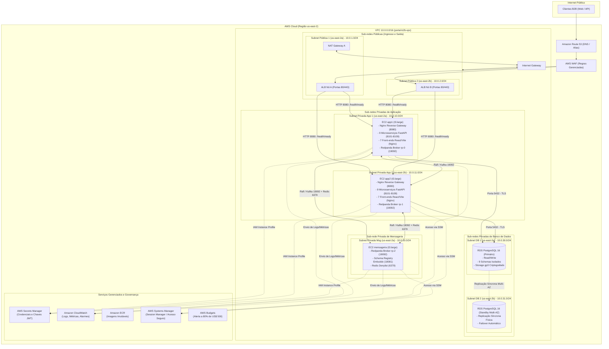
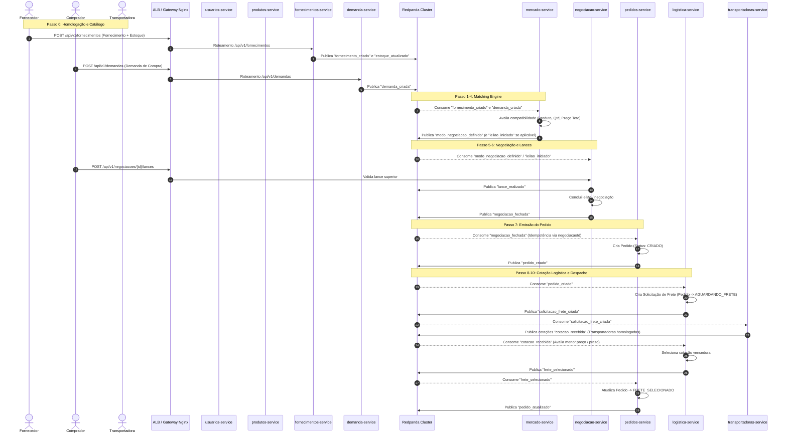
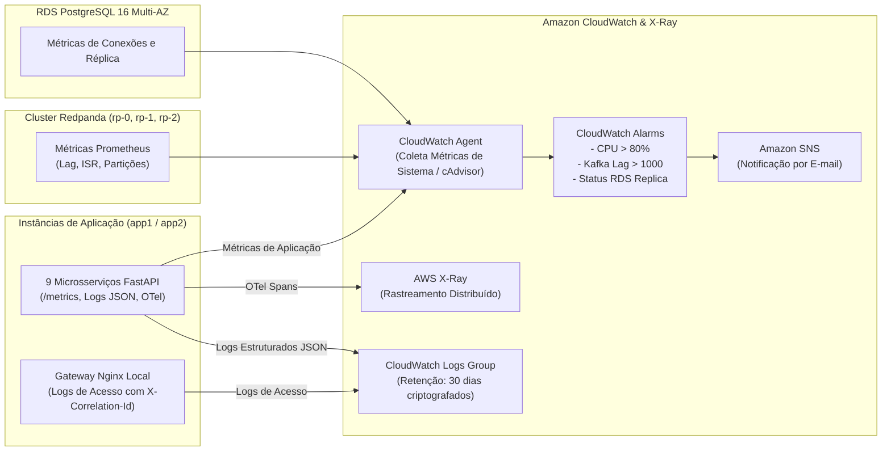
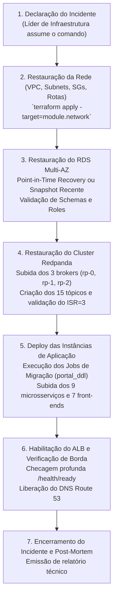

# 01. ARQUITETURA DE REFERÊNCIA AWS — PORTAL B2B DISTRIBUÍDO
**Versão:** 1.0  
**Data:** 2026-10-22  
**Status:** Aprovado para Implementação e Validação  
**Ambiente Alvo:** AWS (`us-east-2` — Ohio, conforme restrição de SCP da conta AWS; mesma tabela de preços de `us-east-1`)  
**Autor:** Arquiteto(a) de Nuvem Sênior (AWS / DevOps / Sistemas Distribuídos)

---

## 1. Visão Geral do Sistema

O **Portal B2B Distribuído** é uma plataforma corporativa projetada para conectar empresas compradoras, fornecedoras e transportadoras em um ecossistema desacoplado, resiliente e orientado a eventos (*event-driven*). A solução orquestra a publicação de demandas de compra, ofertas de fornecimento com controle de estoque, processamento de correspondência (*matching engine*), negociações comerciais automatizadas (via venda direta, leilão direto ou leilão reverso), consolidação de pedidos de compra e cotação/contratação logística com transportadoras homologadas.

### 1.1 Objetivos Arquiteturais
- **Desacoplamento e Assincronismo:** Comunicação inter-serviços baseada em eventos Kafka através do cluster Redpanda, eliminando acoplamento temporal e chamadas síncronas em cascata.
- **Alta Disponibilidade e Resiliência:** Arquitetura ativa-ativa com distribuição em múltiplas Zonas de Disponibilidade (Multi-AZ) na AWS, suportando falhas isoladas de instâncias de aplicação, nós de mensageria ou banco de dados sem indisponibilidade de serviço.
- **Segurança em Profundidade:** Ausência total de acesso administrativo direto via SSH (porta 22 bloqueada), isolamento estrito de rede em sub-redes privadas, segregação de banco por schemas e roles DML de privilégio mínimo, inspeção WAF na borda e gestão centralizada de segredos via AWS Secrets Manager.
- **Eficiência Financeira:** Conformidade estrita com o teto orçamentário mensal de US$ 500 para ambientes ativos em `us-east-2` (mesma tabela de preços de `us-east-1`).

### 1.2 Atores e Domínios do Sistema
O sistema atende quatro perfis de usuários humanos e um ator de processamento autônomo:
1. **Comprador:** Registra demandas de compra pontuais ou recorrentes e participa de leilões e negociações diretas.
2. **Fornecedor:** Cadastra produtos, publica ofertas de fornecimento, monitora estoque e envia lances/propostas.
3. **Transportadora:** Consulta solicitações de frete geradas a partir de pedidos confirmados e submete cotações logísticas competitivas (preço e prazo).
4. **Administrador:** Gerencia empresas, acessos, parâmetros de plataforma e auditoria operacional.
5. **Matching Engine (Processo Interno):** Motor reativo hospedado no `mercado-service` que consome eventos de oferta e demanda, cruzando requisitos de produtos, quantidades e preços para disparar negociações.

---

## 2. Diagramas de Arquitetura

### 2.1 Diagrama de Infraestrutura AWS (Visão Física e de Rede)

A topologia de rede provisionada na região `us-east-2` (Ohio) utiliza uma Virtual Private Cloud (VPC) dedicada subdividida em sub-redes públicas e privadas distribuídas estrategicamente entre duas Zonas de Disponibilidade derivadas dinamicamente da região (`us-east-2a` e `us-east-2b`).



### 2.2 Diagrama de Fluxo de Negócio e Eventos Ponta a Ponta

O fluxo ilustra o ciclo de vida completo de uma transação B2B, cobrindo os passos 1 a 10 da Seção 2 do documento de requisitos.



---

## 3. Decisões de Arquitetura (ADRs)

### ADR-01: Runtime de Execução — Docker Compose em EC2 vs. Kubernetes (EKS) / ECS
- **Status:** Aprovado (Conforme RES-06, D-05)
- **Contexto:** A especificação exige hospedar 9 microsserviços, 7 front-ends estáticos, gateways locais e 1 broker Redpanda por VM, dentro do orçamento estrito de US$ 500/mês (RES-03).
- **Alternativas Consideradas:**
  1. *Amazon EKS:* Custo fixo do control plane (~US$ 73/mês) mais overhead de nodes gerenciados e complexidade de operadores Kafka/Redpanda excederiam o orçamento e a capacidade de 16 GB/4 vCPU do ambiente de desenvolvimento.
  2. *Amazon ECS com Fargate:* Custo elevado por vCPU/hora ao manter ~27 containers ativos ininterruptamente em 2 AZs (estimado em > US$ 400 apenas em computação Fargate).
  3. *Docker Compose em EC2 Ubuntu 22.04 LTS:* Menor custo fixo, paridade total entre ambiente local e AWS, orquestração declarativa simples e compatibilidade nativa com a infraestrutura documentada.
- **Decisão:** Adotar Docker Compose plugin em instâncias EC2 Ubuntu 22.04 LTS.
- **Consequências:** Requer scripts dedicados para orquestração de deploy, health checking e rolling updates (`scripts/rolling_update.sh`).

### ADR-02: Cluster de Mensageria — Redpanda Autogerenciado vs. Amazon MSK
- **Status:** Aprovado (Conforme RES-07)
- **Contexto:** A plataforma demanda mensageria de alta vazão compatível com a API Apache Kafka, além de Schema Registry integrado.
- **Alternativas Consideradas:**
  1. *Amazon MSK (Managed Streaming for Kafka):* Custo mínimo inicial de cluster MSK com 3 brokers (instâncias `kafka.t3.small` ou `m5.large`) ultrapassa US$ 250 a US$ 350/mês, inviabilizando o orçamento total de US$ 500.
  2. *Apache Kafka tradicional em EC2:* Demanda JVM pesada, Apache ZooKeeper ou KRaft com alto consumo de memória RAM por instância.
  3. *Redpanda em C++:* Motor ultrarrápido sem JVM, suporte nativo a Raft, compatibilidade 100% com Kafka API e Schema Registry embutido na porta 18081 sem custos de licenciamento.
- **Decisão:** Provisionar cluster Redpanda com 3 brokers em topologia distribuída.

### ADR-03: Topologia do Cluster Redpanda (2+1)
- **Status:** Aprovado (Conforme seção 4.2 e D-17)
- **Contexto:** Para garantir durabilidade com fator de replicação 3 (`min.insync.replicas=2`, RNF-42), são necessários 3 brokers distintos.
- **Alternativas Consideradas:**
  1. *3 instâncias EC2 exclusivas para mensageria:* Aumentaria o custo de computação em mais 2 instâncias `t3.large` (~US$ 120/mês a mais).
  2. *Topologia Híbrida 2+1:* Broker `rp-0` co-hospedado na `app1`, broker `rp-1` na `app2`, e broker `rp-2` em uma terceira EC2 dedicada em sub-rede isolada.
- **Decisão:** Implementar a topologia 2+1. As instâncias `app1` e `app2` executam um broker cada, enquanto uma EC2 `compute_msg` dedicada executa o terceiro broker, fechando o quórum Raft e suportando a queda de qualquer nó individual sem perda de ISR.

### ADR-04: Banco de Dados — RDS Multi-AZ PostgreSQL 16 vs. Instância EC2 Própria
- **Status:** Aprovado (Conforme RES-08, INF-06, D-02)
- **Contexto:** Necessidade de replicação síncrona física entre Zonas de Disponibilidade, RPO ≤ 5 min (RNF-38), RTO ≤ 60 min (RNF-37) e backups automáticos.
- **Alternativas Consideradas:**
  1. *PostgreSQL autogerenciado em EC2 com Patroni/streaming:* Exigiria complexidade operacional adicional, configuração manual de testemunha e manutenção de rotinas de backup.
  2. *Amazon Aurora PostgreSQL:* Custo por I/O e instância mínima mais elevado.
  3. *Amazon RDS PostgreSQL Multi-AZ:* Provisionamento gerenciado com 1 nó primário e 1 nó standby síncrono em AZs distintas, failover automático transparente (comutação de DNS em ~30-60 s), point-in-time recovery nativo e zero perda de dados confirmados.
- **Decisão:** Adotar RDS PostgreSQL 16 Multi-AZ (`db.t4g.medium` ou `db.t3.medium`).

### ADR-05: Isolamento de Dados — Banco Lógico Único com 9 Schemas e Roles Segregadas
- **Status:** Aprovado (Conforme D-02, RFI-08, RFI-09.1 a RFI-09.3)
- **Contexto:** Atender ao isolamento de microsserviços sem ultrapassar os limites de conexões (RNF-10) e mantendo custos previsíveis.
- **Decisão:** Criar um único banco de dados lógico `portal_b2b` contendo 9 schemas independentes (`usuarios`, `produtos`, `fornecimentos`, `demanda`, `mercado`, `negociacao`, `pedidos`, `logistica`, `transportadoras`). Cada serviço autentica-se com sua role DML correspondente (`svc_*`), sem permissão de leitura ou escrita em schemas alheios. A criação de tabelas é exclusiva da role `portal_ddl`, e a administração geral pertence à role `portal_admin`.

### ADR-06: Roteamento de Borda — Application Load Balancer (ALB) + Nginx Reverso Local
- **Status:** Aprovado (Conforme RFI-01, INF-03, D-04)
- **Contexto:** Oferecer endereço único HTTPS na porta 443, distribuir carga em ativo-ativo (RFI-02), realizar terminação TLS gerenciada e rotear tráfego para os 9 serviços e 7 front-ends.
- **Decisão:** O ALB atua como ponto de entrada público gerenciado, direcionando as requisições para o gateway Nginx local nas portas 8080 das EC2 privadas. O Nginx interno efetua o roteamento por prefixo (`/api/v1/*` para portas 8101-8109 e `/*` para os front-ends), injetando os cabeçalhos de rastreamento (`X-Correlation-Id`, `X-Served-By`).

### ADR-07: Acesso Administrativo Sem Bastion Host — AWS SSM Session Manager
- **Status:** Aprovado (Conforme INF-02, INF-07, RNF-21)
- **Contexto:** Eliminar a superfície de ataque de instâncias públicas e portas SSH abertas na internet.
- **Decisão:** Bloquear categoricamente a porta 22 em todos os Security Groups. O acesso shell e o encaminhamento de portas (*port forwarding*) para ferramentas administrativas (PgAdmin na 5050, Kafka UI na 8090 e Uptime Kuma na 3001) é realizado unicamente via AWS Systems Manager Session Manager autenticado via IAM/AWS CLI.

### ADR-08: Redis Compartilhado na EC2 `compute_msg` — Denylist de Tokens (Identity-Service)
- **Status:** Aprovado (Demanda da Equipe A / Issue #2, conforme RES-03, RES-06, INF-02, RNF-04)
- **Contexto:** O `usuarios-service` (Identity-Service) passou a utilizar Redis (`redis:7.4.6-alpine`, `maxmemory 256mb`, AOF) para manter a denylist de revogação imediata de tokens no logout. Como a camada de aplicação roda em ativo-ativo (`app1` e `app2`), o Redis precisa ser compartilhado entre as duas instâncias para evitar inconsistência de estado (logout no `app1` não invalidando token no `app2`).
- **Alternativas Avaliadas:**
  1. *Redis local em `app1`:* Violaria o RNF-04 (derrubar `app1` no teste de caos indisponibilizaria o Redis para a `app2`).
  2. *Amazon ElastiCache gerenciado:* Acrescentaria custo mensal recorrente por ambiente, pressionando o teto orçamentário de US$ 500 (RES-03).
  3. *Container Redis na EC2 `compute_msg`:* Custo adicional zero, aproveita a folga da `t3.large` de mensageria, mantém a independência das quedas de `app1`/`app2` e isola o acesso via regra explícita na porta `6379` no `msg_sg` apenas para `app_sg`, com senha gerenciada no AWS Secrets Manager (`portal-b2b/<ambiente>/redis`).
- **Decisão:** Executar o container Redis compartilhado na EC2 `compute_msg` (`rp-2`). Trade-off aceito e documentado (análogo à PA-01): indisponibilidade total da VM `compute_msg` afeta a consulta à denylist até a restauração da instância, com impacto mitigado pelo TTL curto dos access tokens (15 min — RNF-17).

---

## 4. Mapeamento de Requisitos para Recursos AWS

A tabela abaixo estabelece o mapeamento rastreável entre os identificadores do documento de requisitos e os recursos concretos da AWS declarados no Terraform.

| ID Requisito | Tipo de Requisito | Recurso AWS Concreto | Módulo Terraform | Descrição / Configuração Implementada |
|---|---|---|---|---|
| **INF-01** | Rede e Topologia | `aws_vpc`, `aws_subnet`, `aws_route_table`, `aws_nat_gateway`, `aws_eip` | `modules/network` | VPC 10.0.0.0/16 com 2 subnets públicas e 4 privadas distribuídas em 2 AZs dinâmicas (`us-east-2a`, `us-east-2b`). |
| **INF-02** | Segurança de Rede | `aws_security_group`, `aws_security_group_rule` | `modules/security` | SGs específicos (`alb_sg`, `app_sg`, `msg_sg`, `rds_sg`). Nenhuma porta 22 aberta. RDS só aceita tráfego da `app_sg`. |
| **INF-03** | Balanceamento e Borda | `aws_lb`, `aws_lb_listener`, `aws_lb_target_group`, `aws_route53_record` | `modules/alb` | ALB com listener 443 (certificado ACM), redirecionamento 80->443, health check profundo em `/health/ready` e DNS Route 53. |
| **INF-04** | Computação Aplicação | `aws_instance` (2x), `aws_ebs_volume` | `modules/compute_app` | 2 instâncias `t3.large` em subnets privadas de AZs distintas, gp3 50 GB criptografado por KMS, registradas no Target Group. |
| **INF-05** | Computação Mensageria | `aws_instance` (1x), `aws_ebs_volume` | `modules/compute_msg` | 1 instância `t3.large` em subnet privada, gp3 50 GB criptografado, dedicada ao broker `rp-2` com SG `msg_sg`. |
| **INF-06** | Banco de Dados Relacional | `aws_db_instance`, `aws_db_subnet_group` | `modules/rds` | PostgreSQL 16 Multi-AZ, `publicly_accessible = false`, `storage_encrypted = true`, backup 7 dias, auto-scaling de storage. |
| **INF-07** | Acesso Administrativo | `aws_iam_role_policy_attachment` (`AmazonSSMManagedInstanceCore`) | `modules/security` | Instâncias EC2 sem `key_name` SSH; canal administrativo exclusivo via SSM Session Manager. |
| **INF-08** | Privilégio Mínimo IAM | `aws_iam_policy`, `aws_iam_role`, `aws_iam_instance_profile` | `modules/security` | Permissão estrita para leitura de segredos específicos no Secrets Manager, envio de logs ao CloudWatch e pull no ECR. |
| **INF-09** | Registro de Containers | `aws_ecr_repository` | `modules/ecr` | Repositórios ECR com `image_tag_mutability = "IMMUTABLE"` e `scan_on_push = true`. |
| **INF-10** | Controle Orçamentário | `aws_budgets_budget` | `modules/budgets` | Alerta automático via SNS/e-mail configurado para 80% do teto mensal (US$ 400 de US$ 500). |
| **INF-11** | Parametrização IaC | Estrutura de diretórios `envs/` com `backend` S3 e DynamoDB | `envs/*` | Ambientes `integracao`, `hml` e `prod` isolados com tags padrão obrigatórias (`Projeto`, `Ambiente`, `Responsavel`). |
| **INF-12** | Automação de Bootstrap | `user_data` script (cloud-init) | `modules/compute_*` | Instalação automatizada do Docker, Docker Compose, AWS CLI, `chrony` (NTP), `psql` e `unattended-upgrades`. |
| **RNF-01** | Disponibilidade Geral | AWS Multi-AZ + ALB Target Group | `modules/alb`, `modules/compute_app`, `modules/rds` | Garantia de redundância em todas as camadas para meta ≥ 99,5% mensal. |
| **RNF-16** | Criptografia na Borda | `aws_acm_certificate`, `aws_lb_listener` | `modules/alb` | Listener HTTPS com TLS 1.2/1.3 e redirecionamento forçado da porta HTTP 80. |
| **RNF-19** | Gestão de Segredos | `aws_secretsmanager_secret`, `aws_secretsmanager_secret_version` | `modules/secrets` | Armazenamento de credenciais do banco, chaves privadas JWT e senhas de serviço; lidos em runtime via IAM. |
| **RNF-22** | Proteção de Borda (WAF) | `aws_wafv2_web_acl`, `aws_wafv2_web_acl_association` | `modules/alb` | WAF com regras gerenciadas `AWSManagedRulesCommonRuleSet` e `AWSManagedRulesKnownBadInputsRuleSet`. |
| **RNF-25** | Rotação de Credenciais | `aws_secretsmanager_secret_rotation` | `modules/secrets` | Integração com Lambda para rotação de senhas do PostgreSQL em prazo ≤ 90 dias. |
| **RNF-32** | Tracing Distribuído | AWS X-Ray Daemon / OpenTelemetry Collector | `modules/observability` | Rastreamento distribuído de ponta a ponta com injeção de Trace ID. |
| **RNF-36** | Retenção de Logs | `aws_cloudwatch_log_group` | `modules/observability` | Log groups criptografados com retenção exata de 30 dias. |
| **RNF-37** | Tempo de Recuperação (RTO) | Procedimento e automação de rebuild | Documentação de Runbook | Meta RTO ≤ 60 minutos comprovada via Terraform plan/apply e scripts de bootstrap. |
| **RNF-38** | Ponto de Recuperação (RPO) | `aws_db_instance` Point-in-Time Recovery | `modules/rds` | Backup contínuo de logs de transação com RPO ≤ 5 minutos. |

---

## 5. Arquitetura de Segurança em Profundidade

### 5.1 Isolamento de Rede e Regras de Security Group
A estratégia de segurança de rede adota a política de "zero confiança" (*zero trust*) interna:
- **Camada Pública (ALB):** O `alb_sg` aceita exclusivamente tráfego de entrada nas portas 80 e 443 originado da internet (`0.0.0.0/0`). O tráfego de saída é restrito às portas 8080 das instâncias de aplicação.
- **Camada de Aplicação (`app_sg`):** Não possui endereço IP público. O tráfego de entrada na porta 8080 é restrito à origem do `alb_sg`. Comunicação inter-broker e inter-serviços na porta 19092 é permitida exclusivamente entre `app_sg` e `msg_sg`. Tráfego de saída é liberado via NAT Gateway apenas para serviços AWS e atualizações de pacotes.
- **Camada de Mensageria (`msg_sg`):** Aceita conexões nas portas 19092 (Kafka/Redpanda), 18081 (Schema Registry) e 6379 (Redis compartilhado para denylist do Identity-Service) unicamente originadas do `app_sg`.
- **Camada de Dados (`rds_sg`):** Bloqueia categoricamente qualquer conexão externa. Aceita conexões na porta 5432 unicamente originadas das instâncias com o `app_sg`.
- **Eliminação da Porta 22:** Nenhuma regra de Security Group autoriza a porta 22 (SSH). Todo o gerenciamento de instâncias ocorre por túnel TLS via AWS Systems Manager.

### 5.2 Identidade e Controle de Acesso (IAM)
- Cada instância EC2 recebe um *IAM Instance Profile* com privilégios estritamente delimitados:
  - Leitura pontual de segredos no AWS Secrets Manager sob o caminho `portal-b2b/<ambiente>/*`.
  - Download de imagens no Amazon ECR sob a política `ecr:GetDownloadUrlForLayer`, `ecr:BatchGetImage`, `ecr:BatchCheckLayerAvailability`.
  - Envio de logs e métricas para o CloudWatch Logs e CloudWatch Metrics.
  - Associação à política gerenciada `AmazonSSMManagedInstanceCore`.
- Nenhuma chave de acesso estática (`AWS_ACCESS_KEY_ID` / `AWS_SECRET_ACCESS_KEY`) é gravada em disco, arquivos de configuração ou variáveis de ambiente.

### 5.3 Criptografia em Repouso e em Trânsito
- **Em Repouso:** Volumes EBS raiz e de dados utilizam criptografia `gp3` gerenciada por chave AWS KMS. A instância RDS PostgreSQL utiliza criptografia de armazenamento via KMS. Os Log Groups do CloudWatch possuem criptografia KMS ativada com *key policy* explícita autorizando o serviço `logs.<região>.amazonaws.com`.
- **Em Trânsito:** O tráfego externo cliente-ALB utiliza TLS 1.2 ou 1.3 obrigatório com cipher suites seguras. A comunicação das aplicações com o RDS utiliza `sslmode=require`. O tráfego entre brokers Redpanda e clientes Kafka utiliza criptografia TLS e autenticação SASL/SCRAM-SHA-256.

### 5.4 Proteção de Ferramentas Administrativas
Ferramentas de suporte operacional (PgAdmin, Kafka UI, Uptime Kuma) são configuradas nos nós EC2 para escuta restrita em `127.0.0.1` (loopback), protegidas por senhas fortes. O acesso de desenvolvedores e DBAs é efetuado através de encaminhamento de portas criptografado via AWS CLI:
```bash
aws ssm start-session --target <instance-id> \
  --document-name AWS-StartPortForwardingSession \
  --parameters '{"portNumber":["5050"],"localPortNumber":["5050"]}'
```

### 5.5 Conformidade com a LGPD (Lei Geral de Proteção de Dados)
- **Minimização de Dados:** Apenas nome e e-mail corporativo de usuários são armazenados no schema `usuarios`.
- **Sanitização de Logs:** Filtros no formatador JSON de logs suprimem senhas, tokens de autorização e e-mails de clientes.
- **Anonimização:** O `usuarios-service` implementa o endpoint `POST /api/v1/usuarios/{id}/anonimizar`, que substitui dados pessoais por identificadores irreconhecíveis (*hash* irreversível), preservando a consistência transacional do histórico de compras.
- **Tratamento Geográfico:** Em ambiente de homologação/PoC na região `us-east-2` (Ohio), utilizam-se dados puramente sintéticos (conforme D-08).

---

## 6. Arquitetura de Observabilidade e Monitoramento

A solução implementa o pilar de observabilidade unificado em métricas, logs e traces distribuídos.



### 6.1 Logs Centralizados
- **Formato Padronizado:** Todos os serviços emitem logs estruturados em JSON para `stdout`/`stderr`:
  ```json
  {
    "timestamp": "2026-10-22T20:15:00.123Z",
    "level": "INFO",
    "service": "pedidos-service",
    "correlationId": "c3b8a6e1-8842-4b2a-bf32-6cf7b7c53d10",
    "message": "Pedido criado com sucesso",
    "aggregateId": "ped-99812"
  }
  ```
- **Rastreamento por Correlation ID:** O cabeçalho `X-Correlation-Id` é validado ou gerado na camada de borda pelo Nginx e propagado por todos os microsserviços através de chamadas HTTP e no cabeçalho do envelope de eventos Kafka.
- **Retenção:** 30 dias obrigatórios em AWS CloudWatch Log Groups com KMS (RNF-36).

### 6.2 Métricas e Alarmes Críticos
1. **Saúde de Instância e Falhas:** Alarme de `UnhealthyHostCount >= 1` no Target Group do ALB por mais de 15 segundos (dispara failover e alerta aos engenheiros).
2. **Consumer Lag do Redpanda:** Monitoramento da defasagem de consumo por grupo (`consumer_lag`). Alarme configurado para `lag > 1000` por mais de 2 minutos (RNF-33).
3. **Conexões PostgreSQL:** Alarme disparado se conexões ativas excederem 80 (limite operacional de 90 conexões com pool de 5 por serviço, RNF-10).
4. **Alerta de Custo:** Alarme do AWS Budgets configurado para disparar notificação com 80% do teto mensal (US$ 400).

---

## 7. Estratégia de Continuidade, Resiliência e Runbook de Recuperação

### 7.1 Metas de Recuperação (RTO / RPO)
- **RTO (Recovery Time Objective):** ≤ 60 minutos (RNF-37).
- **RPO (Recovery Point Objective):** ≤ 5 minutos (RNF-38).

### 7.2 Matriz de Tolerância a Falhas

| Componente Afetado | Comportamento do Sistema | Ação Automática | Ação Manual / Runbook |
|---|---|---|---|
| **Queda da EC2 `app1`** | `app2` absorve 100% do tráfego sem erro 5xx. Broker `rp-1` e `rp-2` mantêm quórum Raft (2 de 3). | O ALB detecta falha em ≤ 15 s e remove `app1` do Target Group. | Provisionar nova EC2 via Terraform e reanexar ao cluster. |
| **Queda do Broker `rp-2`** | `rp-0` e `rp-1` continuam atendendo com ISR = 2 e `min.insync.replicas = 2`. Zero eventos perdidos. | O cluster Redpanda reelege líderes de partição em < 2 s. | Reiniciar container ou restaurar a EC2 `compute_msg`. |
| **Queda do Primário RDS** | Escrita suspensa momentaneamente durante a promoção do nó secundário. | O RDS detecta a falha e promove automaticamente o nó standby na AZ oposta (~30-60 s). O CNAME DNS do RDS é atualizado. | Nenhuma ação manual no banco; validar restabelecimento do pool de conexões das APIs. |

### 7.3 Runbook Detalhado de Recuperação de Desastres (DR)

Em caso de colapso estrutural do ambiente, a restauração segue a **ordem estrita de precedência:**
$$\text{Rede} \longrightarrow \text{RDS PostgreSQL} \longrightarrow \text{Redpanda Cluster} \longrightarrow \text{Aplicações (app1/app2)} \longrightarrow \text{ALB / Gateway}$$



#### Procedimento Passo a Passo:
1. **Declaração do Incidente:** O líder da Equipe de Infraestrutura declara formalmente o incidente crítico, abrindo sala de comando e registrando o timestamp inicial ($T_0$).
2. **Reconstrução da Infraestrutura Base:**
   ```bash
   cd terraform/envs/prod
   terraform init
   terraform apply -target=module.network -target=module.security -target=module.secrets -auto-approve
   ```
3. **Restauração e Verificação do Banco de Dados:**
   - Se o RDS original estiver corrompido, executar a restauração a partir do último snapshot ou Point-in-Time Recovery:
     ```bash
     aws rds restore-db-instance-to-point-in-time \
       --source-db-instance-identifier portal-b2b-rds \
       --target-db-instance-identifier portal-b2b-rds-restored \
       --restore-time $(date -u -d '10 minutes ago' +%Y-%m-%dT%H:%M:%SZ) \
       --db-subnet-group-name portal-b2b-dbsubnet
     ```
   - Validar a integridade das tabelas e roles executando consulta de contagem em `pg-primary`.
4. **Restauração do Cluster de Mensageria:**
   - Inicializar as instâncias EC2 de mensageria e aplicação.
   - Verificar a formação do quórum de 3 nós:
     ```bash
     rpk cluster info --brokers localhost:19092
     ```
   - Executar o job de criação e verificação dos 15 tópicos de negócio com fator de replicação 3 e particionamento configurado.
5. **Deploy das Aplicações e Migrações:**
   - Executar os jobs de migração com a role `portal_ddl` para assegurar que todos os 9 schemas estejam íntegros.
   - Inicializar os containers de aplicação via `scripts/deploy.sh`.
   - Validar `/health/live` e `/health/ready` em cada um dos 9 microsserviços.
6. **Reativação do Tráfego:**
   - Reconectar o ALB ao Target Group.
   - Validar que o health check do ALB em `/health/ready` retorne HTTP 200 para ambas as instâncias.
7. **Encerramento:** O líder de Infraestrutura declara o incidente encerrado após 15 minutos de operação contínua sem erros 5xx.

---

## 8. Estimativa Detalhada de Custo Mensal (AWS `us-east-2`)

A estimativa considera operação contínua (730 horas/mês) na região `us-east-2` (Ohio — mesma tabela de preços de `us-east-1`, adotada conforme SCP da conta AWS), projetada para rigorosa conformidade com o teto de **US$ 500/mês** (RES-03).

### 8.1 Tabela de Custos Detalhada por Componente

| Componente | Tipo / Dimensionamento | Qtd | Preço Unitário Mensal | Custo Total Estimado (USD) | Premissas Adotadas |
|---|---|---|---|---|---|
| **EC2 Aplicação** | `t3.large` On-Demand (2 vCPU, 8 GB RAM) | 2 | US$ 60,74 | US$ 121,48 | Instâncias `app1` e `app2` ativas ininterruptamente. |
| **EC2 Mensageria** | `t3.large` On-Demand (2 vCPU, 8 GB RAM) | 1 | US$ 60,74 | US$ 60,74 | Hospedagem do broker `rp-2` dedicado. |
| **Armazenamento EBS** | EBS `gp3` 50 GB criptografado (3000 IOPS, 125 MB/s) | 3 | US$ 4,00 (US$ 0,08/GB) | US$ 12,00 | 50 GB para cada uma das 3 instâncias EC2. |
| **RDS PostgreSQL** | `db.t4g.medium` Multi-AZ (2 vCPU, 4 GB RAM) | 1 | US$ 106,58 | US$ 106,58 | PostgreSQL 16 com nó standby em AZ distinta. |
| **Armazenamento RDS** | Armazenamento gp3 Multi-AZ 50 GB | 1 | US$ 11,50 (US$ 0,23/GB Multi-AZ) | US$ 11,50 | Espaço inicial com expansão automática. |
| **RDS Backups** | Armazenamento de Backup Adicional | 50 GB | US$ 0,095/GB | US$ 4,75 | Retenção contínua de 7 dias (além do free tier de storage). |
| **Load Balancer (ALB)** | Application Load Balancer + LCUs básicas | 1 | US$ 22,50 (base + 1 LCU) | US$ 22,50 | Tráfego web com SSL offloading. |
| **NAT Gateway** | 1 NAT Gateway em `us-east-2a` + Processamento de Dados | 1 | US$ 32,85 (base) + US$ 9,00 (dados) | US$ 41,85 | Premissa PA-01: 1 NAT compartilhado em ambiente controlado. |
| **AWS Secrets Manager** | Segredos armazenados + Requisições de API | 10 segredos | US$ 0,40 / segredo | US$ 4,50 | Segredos por ambiente e credenciais de banco. |
| **Amazon CloudWatch** | Logs ingeridos (10 GB) + Métricas + Alarmes | Diversos | US$ 0,50/GB logs + US$ 0,10/alarme | US$ 12,00 | 30 dias de retenção com expiração automática. |
| **AWS WAF** | Web ACL + 2 Regras Gerenciadas + Requisições | 1 Web ACL | US$ 5,00 (ACL) + US$ 2,00 (regras) + US$ 6,00 | US$ 13,00 | Inspeção na borda contra injeções e bots. |
| **Amazon Route 53** | Hosted Zone pública + Consultas DNS | 1 | US$ 0,50 / zona | US$ 1,50 | Roteamento do domínio para o ALB. |
| **Amazon ECR** | Armazenamento de imagens de containers | 20 GB | US$ 0,10 / GB | US$ 2,00 | 9 serviços + 7 front-ends compilados. |
| **Transferência de Dados** | Egress para a Internet | 100 GB | US$ 0,09 / GB | US$ 9,00 | Volume médio de tráfego de saída. |
| **TOTAL ESTIMADO** | | | | **US$ 423,40** | **Margem de segurança: US$ 76,60 (15,3% abaixo de US$ 500)** |

---

## 9. Análise de Riscos Técnicos e Mitigações

| # | Risco Identificado | Severidade | Probabilidade | Impacto | Estratégia de Mitigação Arquitetural |
|---|---|---|---|---|---|
| **R-01** | Esgotamento de memória RAM nas EC2 de aplicação com ~27 containers e 1 broker Redpanda (D-17). | Alta | Média | Travamento por OOM (*Out Of Memory*), degradação e reinicialização de containers. | Configuração rigorosa de limites de memória (`mem_limit: 384m`) em cada container Docker Compose; ajuste de swap em EBS; monitoramento contínuo em `hml`. |
| **R-02** | Esgotamento do limite de conexões do PostgreSQL (limite de 100 conexões simultâneas). | Média | Alta | Erro `too many connections` rejeitando requisições de negócio. | Pool estrito de no máximo 5 conexões por microsserviço (RNF-10). Total teórico máximo: $9 \text{ serviços} \times 2 \text{ instâncias} \times 5 = 90$ conexões. |
| **R-03** | Assimetria de custos com NAT Gateway duplo em 2 AZs ultrapassando o orçamento de US$ 500. | Alta | Alta | Estouro orçamentário mensal (US$ 500) gerando alertas e bloqueios. | Premissa PA-01: Provisionamento de 1 NAT Gateway centralizado para ambientes não produtivos, mantendo custos em ~US$ 423/mês. |
| **R-04** | Perda de quórum Raft no Redpanda caso duas instâncias sofram indisponibilidade simultânea. | Crítica | Baixa | Indisponibilidade de escrita e leitura de eventos em todos os microsserviços. | Distribuição física dos 3 nós entre `app1` (AZ A), `app2` (AZ B) e `compute_msg` (AZ A dedicada); persistência em discos EBS gp3 desacoplados do ciclo de vida das VMs. |
| **R-05** | Vazamento de credenciais ou segredos em imagens Docker ou repositórios Git. | Crítica | Baixa | Comprometimento de segurança da infraestrutura de banco e mensageria. | Varredura automatizada com Gitleaks em CI/CD; proibição de credenciais hardcoded; injeção dinâmica via AWS Secrets Manager. |
| **R-06** | Incompatibilidade de contratos de eventos Kafka entre equipes autônomas. | Média | Média | Falhas de desserialização e mensagens descartadas no DLT. | Schema Registry obrigatório na porta 18081 com política `BACKWARD`; validação de JSON Schema no envelope padronizado antes da publicação. |

---

## 10. Lista de Premissas Assumidas (PA-xx)

Conforme regras **R1** e **R2**, todas as definições operacionais não explicitadas no documento original foram consolidadas como premissas formais:

- **PA-01:** Utilização de um único NAT Gateway em `us-east-2a` para roteamento de saída das sub-redes privadas em ambientes de laboratório, integração e homologação, garantindo a permanência do custo total abaixo de US$ 500/mês (RES-03). Em ambiente de produção estrito com expansão orçamentária, um segundo NAT Gateway em `us-east-2b` poderá ser ativado.
- **PA-02:** A instância do RDS PostgreSQL Multi-AZ é provisionada no tipo `db.t4g.medium` (arquitetura AWS Graviton2, 2 vCPU, 4 GB RAM) oferecendo excelente relação custo/benefício, suporte a até 100 conexões simultâneas e latência reduzida.
- **PA-03:** O roteamento de DNS público é implementado no Amazon Route 53 utilizando registros de Alias (tipo A) vinculados diretamente ao DNS estável do Application Load Balancer (ALB).
- **PA-04:** Os 7 front-ends estáticos React/Vite são compilados em builds multi-estágio e empacotados em imagens com Nginx Alpine, executando localmente dentro das instâncias EC2 e servidos através dos subcaminhos oficiais sob o gateway reverso.
- **PA-05:** A autenticação utiliza tokens JWT (JSON Web Token) assinados com algoritmo assimétrico RS256. A chave privada reside com exclusividade no `usuarios-service` (injetada via Secrets Manager), e a chave pública é distribuída para validação stateless nos demais serviços através do endpoint `/api/v1/usuarios/.well-known/jwks.json`.
- **PA-06:** O Schema Registry embutido do cluster Redpanda (porta 18081) atua como fonte da verdade para o catálogo dos 15 contratos de eventos em JSON Schema.
- **PA-07:** Para o quórum Raft do Redpanda, os nós `rp-0` e `rp-1` residem respectivamente nas instâncias `app1` e `app2`, enquanto `rp-2` opera na instância dedicada de mensageria, assegurando fator de replicação 3 e ISR mínimo de 2 (RNF-42).
- **PA-08:** O banco de dados físico PostgreSQL contém o catálogo lógico `portal_b2b` estruturado com 9 schemas (`usuarios`, `produtos`, `fornecimentos`, `demanda`, `mercado`, `negociacao`, `pedidos`, `logistica`, `transportadoras`). Cada microsserviço conecta-se exclusivamente com sua credencial DML dedicada (`svc_*`).
- **PA-09:** A criação e alteração de tabelas e índices é vedada em tempo de execução para os microsserviços, sendo executada unicamente por jobs efêmeros de migração (Alembic/Flyway) operando com a role privilegiada `portal_ddl` (SW-06, RFI-09.2).
- **PA-10:** A trilha de auditoria (RNF-24) é persistida na tabela `audit_log` contida nos schemas críticos, onde as roles de runtime possuem apenas permissão de `INSERT`, sendo revogados `UPDATE` e `DELETE`.
- **PA-11:** Em ambiente local (PoC), o Application Load Balancer é emulado por um container Nginx de borda escutando em `localhost:8080` (HTTP) e `localhost:8443` (HTTPS autoassinado), distribuindo requisições entre `app1` e `app2` com inserção do cabeçalho `X-Served-By`.
- **PA-12:** A retenção de logs no CloudWatch é parametrizada em exatamente 30 dias (RNF-36) com descarte automático de eventos antigos.
- **PA-13:** As regras gerenciadas pelo AWS WAF no ALB englobam `AWSManagedRulesCommonRuleSet` e `AWSManagedRulesKnownBadInputsRuleSet` com contagem e bloqueio ativos.
- **PA-14:** O orçamento configurado no AWS Budgets dispara notificações automáticas via Amazon SNS para a equipe de infraestrutura ao atingir 80% do teto mensal previsto (US$ 400).
- **PA-15:** Certificados TLS para os ambientes em nuvem são gerenciados sem custo adicional pelo AWS Certificate Manager (ACM), associados aos listeners HTTPS dos ALBs.

---

## 11. O Que a PoC NÃO Prova

Embora a PoC (Prova de Conceito) local em Docker Compose valide a lógica de negócio distribuída, a compatibilidade de contratos, a orquestração multi-serviços e a tolerância funcional a falhas, existem restrições fundamentais inerentes ao ambiente simulado que **apenas a infraestrutura AWS real é capaz de provar:**

1. **Alta Disponibilidade e Latência Multi-AZ Real:** Na PoC, todos os containers rodam no mesmo kernel e barramento de hardware local. A PoC não simula a latência de rede inter-AZ (0,8 ms - 2,0 ms na AWS), eventuais partições de rede reais (*network splits*) ou degradações de comutação física.
2. **Failover de DNS e Comutação do RDS Multi-AZ:** O failover local de banco é executado via script manual ou comutação de alias de rede (`promote_replica.sh`). Na AWS, o failover do RDS envolve comutação automática de registro CNAME interno gerenciado pela AWS, perda temporária de sockets TCP e reconexão coordenada via pool de aplicações.
3. **Escala e Throughput Real de I/O de Disco (EBS gp3):** A PoC utiliza o sistema de arquivos do sistema operacional hospedeiro. O comportamento de *burst* de IOPS, *throttling* de volume EBS gp3 a 3000 IOPS / 125 MB/s e latências de gravação síncrona do PostgreSQL e Redpanda sob carga real só podem ser aferidos na nuvem.
4. **Comportamento sob Ataques e Regras de Borda (WAF/DDoS):** A PoC utiliza Nginx básico com `limit_req`. A eficácia contra ataques complexos de camada 7 (SQLi, XSS, bots distribuídos) depende das assinaturas atualizadas do AWS WAF e do AWS Shield Standard.
5. **Comutação de Certificados e Ciclo de Vida ACM:** A PoC emprega certificados estáticos autoassinados com bypass de verificação (`curl -k`). O provisionamento automático, validação DNS e rotação transparente promovidos pelo AWS Certificate Manager (ACM) só existem na AWS.
6. **Políticas de IAM e Segurança de Instância Real:** No Docker local, a comunicação inter-container depende de redes de bridge. Na AWS, a autorização depende de credenciais temporárias providas pelo serviço de metadados da instância (IMDSv2) validadas pelo AWS IAM.
7. **Desempenho sob Carga Extrema Concorrente:** A capacidade de sustentar 200 usuários concorrentes simultâneos com 100 req/s e 20 eventos/s distribuídos de forma equilibrada entre duas máquinas virtuais `t3.large` físicas requer validação empírica em ambiente de homologação (`hml`).

---

## 12. Autoverificação Informativa da Etapa 1 (Regra R10)

Em estrito cumprimento à regra **R10**, apresenta-se a relação dos identificadores de requisitos cobertos e analisados nesta etapa arquitetural:

### IDs Cobertos Nesta Etapa (Análise Arquitetural, Mapeamento e Desenho)
- **Requisitos de Nuvem e Infraestrutura (INF):** `INF-01`, `INF-02`, `INF-03`, `INF-04`, `INF-05`, `INF-06`, `INF-07`, `INF-08`, `INF-09`, `INF-10`, `INF-11`, `INF-12`.
- **Requisitos Não Funcionais Críticos (RNF):** `RNF-01`, `RNF-02`, `RNF-03`, `RNF-04`, `RNF-05`, `RNF-06`, `RNF-07`, `RNF-08`, `RNF-09`, `RNF-10`, `RNF-11`, `RNF-12`, `RNF-13`, `RNF-14`, `RNF-15`, `RNF-16`, `RNF-17`, `RNF-18`, `RNF-19`, `RNF-20`, `RNF-21`, `RNF-22`, `RNF-23`, `RNF-24`, `RNF-25`, `RNF-26`, `RNF-27`, `RNF-28`, `RNF-29`, `RNF-30`, `RNF-31`, `RNF-32`, `RNF-33`, `RNF-34`, `RNF-35`, `RNF-36`, `RNF-37`, `RNF-38`, `RNF-39`, `RNF-40`, `RNF-41`, `RNF-42`, `RNF-43`.
- **Restrições Arquiteturais Globais (RES):** `RES-01`, `RES-02`, `RES-03`, `RES-04`, `RES-05`, `RES-06`, `RES-07`, `RES-08`, `RES-09`, `RES-10`, `RES-11`, `RES-12`, `RES-13`, `RES-14`.
- **Decisões e Pendências Consolidadas (D):** `D-01` a `D-19`.
- **Premissas Assumidas:** `PA-01` a `PA-15`.

### IDs Não Cobertos Diretamente Nesta Etapa (Destinados à Implementação de Código nas Etapas 2 e 4)
- *Código Terraform concreto:* Transferido para a **Etapa 2** (`saida/02-terraform/`).
- *Implementação de APIs, Front-ends e PoC:* Transferidos para a **Etapa 4** (`saida/04-poc/` - `RF-01` a `RF-18`, `SW-01` a `SW-08`, `CT-A01` a `CT-A08`, `CT-E01` a `CT-E09`).
- *Critérios de Aceite Globais (CA):* Validados na matriz de rastreabilidade e na suíte de testes automatizados das Etapas 4 e 5.

*(Observação: Em conformidade com a Regra R11, nenhuma nota ou porcentagem de conformidade foi atribuída nesta autoverificação).*
